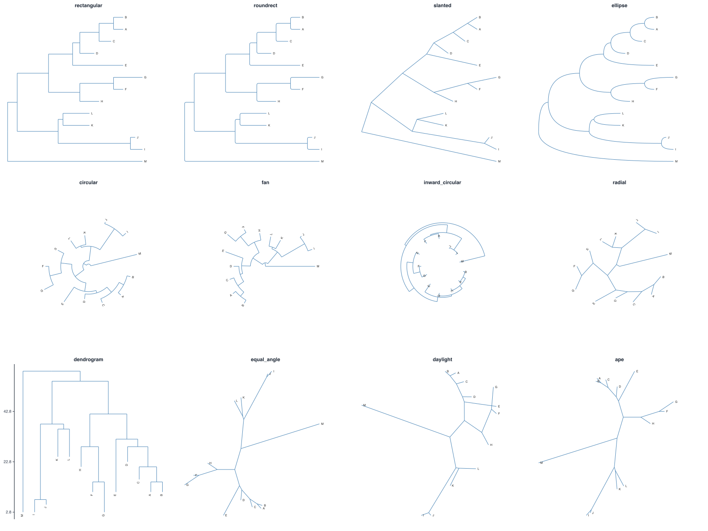
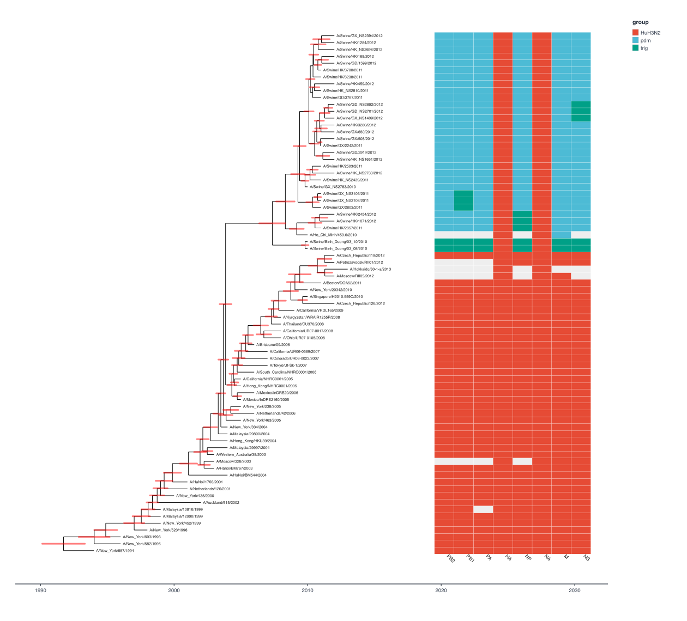
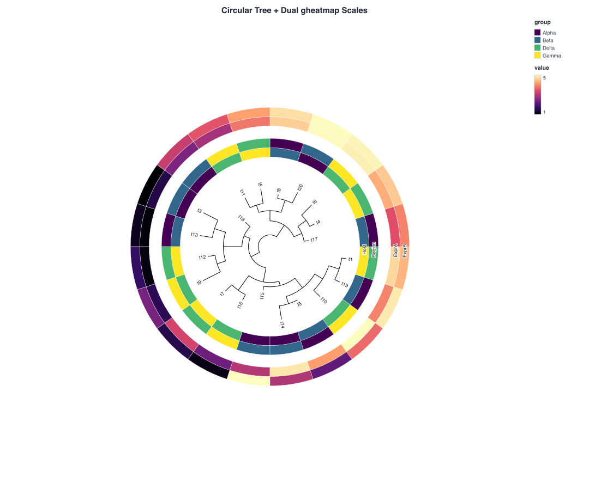
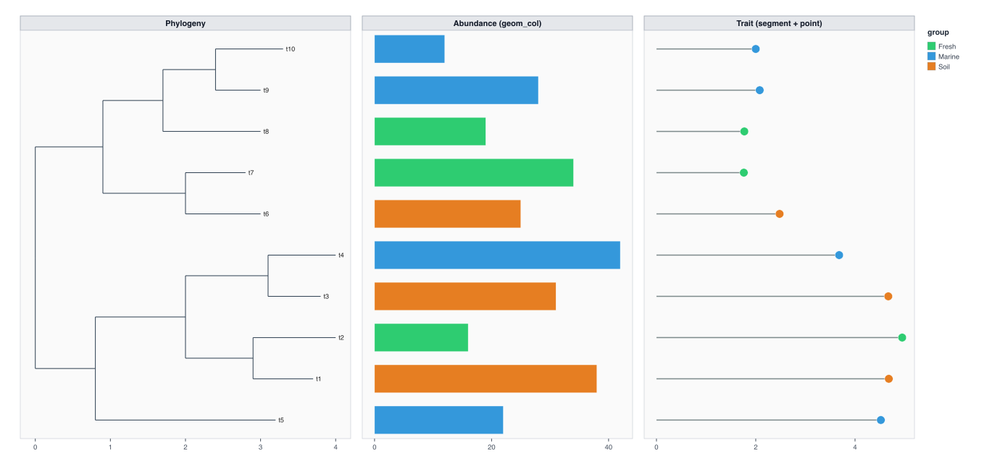
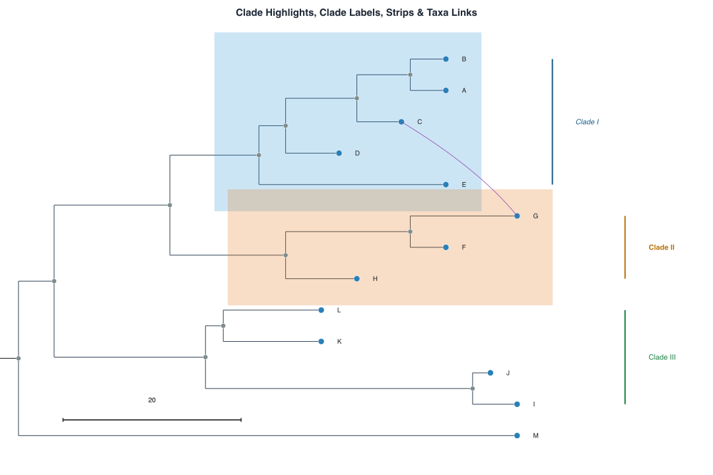
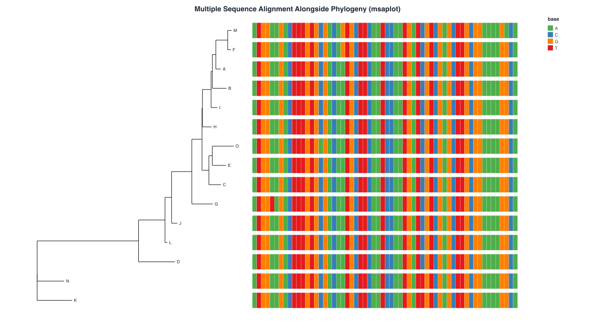
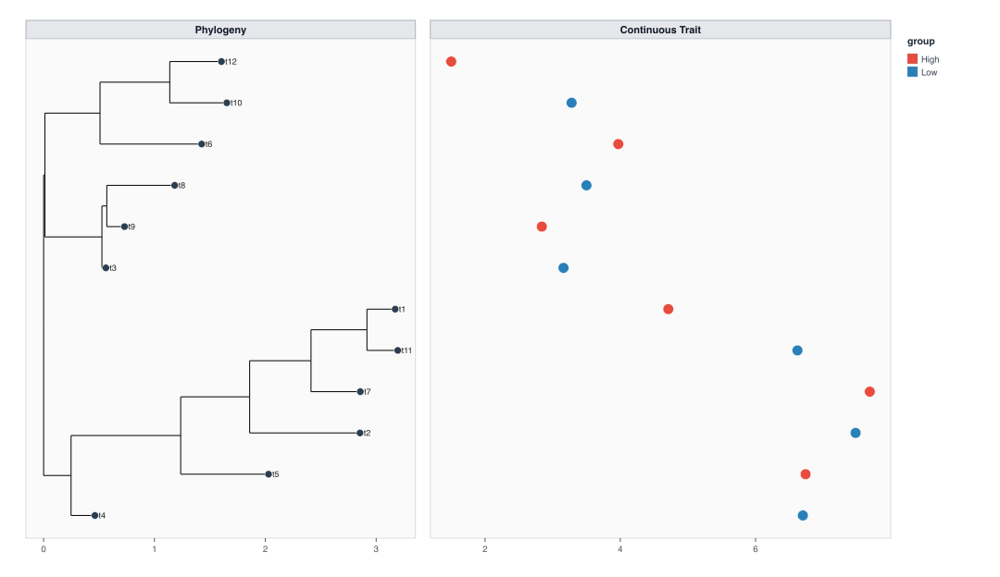
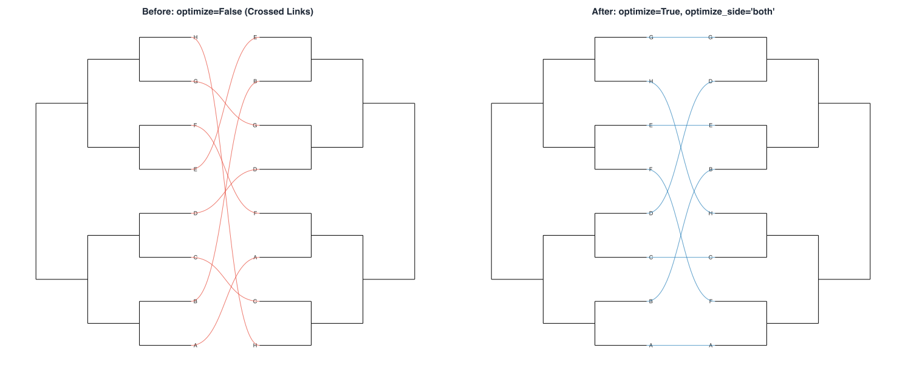
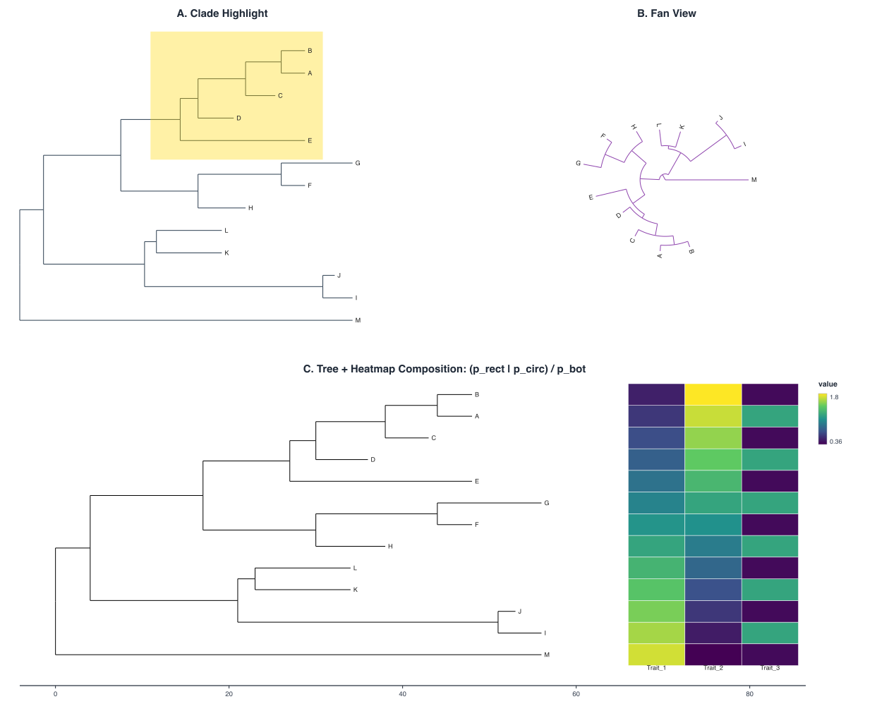

# ggtree-py

**Grammar of Graphics for Phylogenetic Trees in Python** — an R-compatible Python port of the Bioconductor [`ggtree`](https://github.com/YuLab-SMU/ggtree) ecosystem (`treeio`, `tidytree`, `treelayout`, `ggtree`).

`ggtree-py` provides the `ggtree` Python package (`import ggtree`) with layered `+` plot composition, symbolic `aes(...)` expressions, 12+ phylogenetic tree layouts, evolutionary time-scale mapping (`mrsd`, `revts()`), clade manipulation, heatmaps (`gheatmap`), multiple sequence alignments (`msaplot`), multi-panel facets (`geom_facet`), node pie/bar insets (`nodepie`, `nodebar`, `inset`), tanglegrams (`ggdoubletree`), `pandas`/`polars`/`pyarrow` DataFrame interoperability, interactive HTML/Jupyter figures (`to_interactive()`, `girafe()`), and built-in vector SVG/PDF and PNG rendering with **only `numpy` required at runtime**.

| 12+ Tree Layouts | BEAST Time Tree + `gheatmap()` |
| :---: | :---: |
| [](https://zhanxw.github.io/ggtree-py/layouts_and_manipulation.html) | [](https://zhanxw.github.io/ggtree-py/annotations_and_compositions.html) |
| **Circular Dual-Scale Heatmaps** | **Multi-Panel Facets (`geom_col` + Dot Plot)** |
| [](https://zhanxw.github.io/ggtree-py/annotations_and_compositions.html#multiple-fillcolor-scales-new_scale_fill-new_scale_color) | [](https://zhanxw.github.io/ggtree-py/annotations_and_compositions.html#3-faceted-data-panels-geom_facet--facet_plot) |

📖 **Read the Online Book:** [**Data Integration, Manipulation and Visualization of Phylogenetic Trees (*ggtree-py* Edition)**](https://zhanxw.github.io/ggtree-py-book/) — 13 chapters, FAQs, API reference, and [**111 reproducible figures**](https://zhanxw.github.io/ggtree-py-book/gallery.html) with collapsible Python code.

Browse all **28 rendered figures** in the [**Visual Gallery**](https://zhanxw.github.io/ggtree-py/gallery.html).

---

## Installation

```bash
pip install ggtree-py
```

### Requirements

- **Python** `>= 3.10`
- **Runtime dependency**: `numpy >= 1.22`
- **Optional DataFrame extras**: `pip install "ggtree-py[pandas]"`, `"ggtree-py[polars]"`, or `"ggtree-py[dataframe]"` (`pandas`, `polars`, `pyarrow`)
- **Optional external renderers**: [`rsvg-convert`](https://wiki.gnome.org/Projects/LibRsvg) (`librsvg`) or `cairosvg` (`pip install "ggtree-py[pdf]"`) for external PNG/PDF rendering (automatically falls back to built-in pure-NumPy RGBA PNG rasterization and a pure-Python `%PDF-1.4` vector compiler when neither is installed).

### Local Development Install

```bash
git clone https://github.com/zhanxw/ggtree-py.git
cd ggtree-py
pip install -e ".[dev]"
python3 -s -m unittest discover -s tests -v
python3 -s examples/run_all_examples.py
```

---

## Quickstart

### 1. Annotated Tree (`+` Layers & Clade Highlights)

```python
import ggtree as gg

tree = gg.read_tree(gg.system_file("extdata", "sample.nwk", package="treeio"))
mrca_il = gg.MRCA(tree, "I", "L")

p = (
    gg.ggtree(tree)
    + gg.geom_tippoint(color="steelblue", size=2)
    + gg.geom_nodepoint(gg.aes(subset=~gg.isTip), color="orange", size=2)
    + gg.geom_text2(gg.aes(subset=~gg.isTip, label=gg.node), hjust=-0.3, size=2.5)
    + gg.geom_tiplab(align=True, linetype="dotted", offset=0.2)
    + gg.geom_hilight(node=mrca_il, fill="steelblue", alpha=0.35, to_bottom=True)
    + gg.geom_cladelab(node=mrca_il, label="italic('Clade IL')", parse=True, offset=2.0)
    + gg.geom_strip("A", "C", label="Strip AC", offset=2.0, angle="auto")
    + gg.geom_taxalink("A", "E", color="firebrick")
    + gg.geom_treescale()
    + gg.theme_tree2()
    + gg.ggtitle("Annotated Sample Tree")
)

gg.ggsave("annotated_tree.svg", plot=p, width=9.5, height=6.5)
gg.ggsave("annotated_tree.png", plot=p, width=9.5, height=6.5, dpi=100)
```



### 2. Time-Scaled BEAST Tree + HPD Intervals + Genotype Heatmap

```python
from ggtree import *

beast_tree = read_beast(system_file("extdata/MCC_FluA_H3.tree", package="ggtree"))
genotype = read_table(system_file("extdata/Genotype.txt", package="ggtree"), sep="\t")

p_beast = (
    ggtree(beast_tree, mrsd="2013-01-01")
    + geom_range("height_0.95_HPD", color="red", size=1.5, alpha=0.5)
    + geom_tiplab(size=2)
    + theme_tree2()
)

p_hm = (
    gheatmap(p_beast, genotype, offset=5, width=0.5, font_size=3, colnames_angle=-45, hjust=0)
    + ggtitle("FluA H3 BEAST Tree + Genotype Heatmap")
)
ggsave("beast_gheatmap.png", plot=p_hm, width=11, height=11, dpi=100)
```


### 3. Multi-Scale Circular Heatmaps (`new_scale_fill`)

```python
from ggtree import *

set_seed(2026)
tr = read_tree(system_file("extdata", "sample.nwk", package="treeio"))
df1 = DataFrame(
    {
        "first": ["a", "b", "a", "c", "d", "d", "a", "b", "e", "e", "f", "c", "f"],
        "second": ["z", "z", "z", "z", "y", "y", "y", "y", "x", "x", "x", "a", "a"],
    },
    rownames=tr.tip_label,
)
df2 = DataFrame({"M1": rnorm(13).tolist(), "M2": rnorm(13).tolist()}, rownames=tr.tip_label)

p1 = gheatmap(ggtree(tr, layout="circular"), df1, offset=0.8, width=0.2) + scale_fill_viridis_d(option="D") + new_scale_fill()
p2 = gheatmap(p1, df2, offset=12.8, width=0.3) + scale_fill_viridis_c(option="A")
ggsave("circular_stacked_heatmap.svg", plot=p2, width=9, height=8.5)
```


### 4. Composite Plots, MSA, Facets, and Tanglegrams

```python
from ggtree import *

# Patchwork composition with | and /
p_patch = (
    (ggtree(tr) + geom_tiplab(size=2.5) + ggtitle("Rectangular"))
    | (ggtree(tr, layout="fan", open_angle=120) + ggtitle("Fan"))
) / (ggtree(tr, layout="tidy") + geom_tiplab(size=2.5) + ggtitle("Tidy"))

# Multiple sequence alignment
pa_tree = read_tree(system_file("extdata/pa.nwk", package="ggtree"))
p_msa = msaplot(ggtree(pa_tree) + geom_tiplab(size=2.5), fasta=system_file("extdata/pa.fas", package="ggtree"), window=(1, 60))

# Phylogeny + trait panel facet_plot / geom_facet
trait_df = DataFrame({"id": tr.tip_label, "value": rnorm(len(tr.tip_label)).tolist()})
p_facet = ggtree(tr) + geom_tiplab() + geom_facet(panel="Trait", data=trait_df, geom=geom_point, mapping=aes(x="value"))

# Crossing-minimized tanglegram
t1 = read_tree(text="(((a:1,b:1):1,c:2):1,(d:1.5,e:1.5):1.5);")
t2 = read_tree(text="((e:1.5,d:1.5):1.5,(c:2,(b:1,a:1):1):1);")
p_tangle = ggdoubletree(ggtree(t1) + geom_tiplab(), ggtree(t2) + geom_tiplab(), optimize=True, optimize_side="both")
```

| Multiple Sequence Alignment (`msaplot`) | Phylogeny + Trait Facet (`geom_facet`) |
| :---: | :---: |
|  |  |
| **Untangled `ggdoubletree()`** | **Patchwork Grid (`\|` & `/`)** |
|  |  |

---

## R ↔ Python Operator & Syntax Cheatsheet

| R `ggtree` | Python `ggtree` | Notes |
| --- | --- | --- |
| `p + layer` | `p + layer` | Immutable copy returning updated `GGTree` |
| `p %<+% df` | `p % df` (also `<<`, `@`) | Left-joins external `DataFrame` onto tree node data |
| `p %<% new_tree` | `p % new_tree` (also `<<`, `@`) | Replaces the underlying tree while preserving layers/themes |
| `aes(subset = !isTip)` | `aes(subset=~isTip)` | Bitwise `~` negates symbolic expressions (`~isTip`, `"!isTip"`) |
| `read.tree(...)`, `read.beast(...)` | `read_tree(...)`, `read_beast(...)`, or `read.tree(...)`, `read.beast(...)` | Dot-call proxies (`read`, `write`, `system`, `data`, `set_`, `as_`, `is_`) supported |
| `p1 \| p2`, `p1 / p2` | `p1 \| p2`, `p1 / p2` | Nested patchwork composition returning `PlotList` |
| `TRUE`, `FALSE`, `NA`, `NULL` | `True`/`TRUE`, `False`/`FALSE`, `None`/`NA`/`NULL` | R constants exported from `ggtree` |

---

## Documentation

- 📖 **[Online Book (*treedata-book* Python Edition)](https://zhanxw.github.io/ggtree-py-book/)** — Complete 13-chapter interactive book (Parts I–IV, FAQ Appendix A, API Appendix B)
- 🖼️ **[Online Book Figure Gallery & Master Index (111 Figures)](https://zhanxw.github.io/ggtree-py-book/gallery.html)** — Searchable gallery with collapsible Python code for every figure

Full guides and reference pages are also hosted on [**GitHub Pages**](https://zhanxw.github.io/ggtree-py/) and in [`docs/`](https://github.com/zhanxw/ggtree-py/tree/main/docs):

- [Documentation Index](https://zhanxw.github.io/ggtree-py/) ([Markdown](https://github.com/zhanxw/ggtree-py/blob/main/docs/index.md))
- [Visual Gallery (28 Figures)](https://zhanxw.github.io/ggtree-py/gallery.html) ([Markdown](https://github.com/zhanxw/ggtree-py/blob/main/docs/gallery.md))
- [Getting Started & Tree Data I/O](https://zhanxw.github.io/ggtree-py/getting_started.html) ([Markdown](https://github.com/zhanxw/ggtree-py/blob/main/docs/getting_started.md))
- [Layouts & Tree Manipulation](https://zhanxw.github.io/ggtree-py/layouts_and_manipulation.html) ([Markdown](https://github.com/zhanxw/ggtree-py/blob/main/docs/layouts_and_manipulation.md))
- [Annotations, Heatmaps, Facets & Multi-Tree Compositions](https://zhanxw.github.io/ggtree-py/annotations_and_compositions.html) ([Markdown](https://github.com/zhanxw/ggtree-py/blob/main/docs/annotations_and_compositions.md))
- [API Reference](https://zhanxw.github.io/ggtree-py/api_reference.html) ([Markdown](https://github.com/zhanxw/ggtree-py/blob/main/docs/api_reference.md))
- [R-to-Python Migration Guide](https://zhanxw.github.io/ggtree-py/r_to_python_migration.html) ([Markdown](https://github.com/zhanxw/ggtree-py/blob/main/docs/r_to_python_migration.md))

---

## Citation & Upstream Credit

This library is a Python port of **Bioconductor `ggtree`** (`v4.3.2`) originally created by **Guangchuang Yu**, **Tommy Tsan-Yuk Lam**, **Shuangbin Xu**, and contributors ([YuLab-SMU/ggtree](https://github.com/YuLab-SMU/ggtree)).

If you use `ggtree` in published research, please cite the original papers:

1. S Xu, L Li, X Luo, M Chen, W Tang, L Zhan, Z Dai, TT Lam, Y Guan, **G Yu**. Ggtree: A serialized data object for visualization of a phylogenetic tree and annotation data. ***iMeta***, 2022, 1(4):e56. doi: [10.1002/imt2.56](https://doi.org/10.1002/imt2.56)
2. **G Yu**. *Data Integration, Manipulation and Visualization of Phylogenetic Trees* (1st edition). ***Chapman and Hall/CRC***, 2022. doi: [10.1201/9781003279242](https://doi.org/10.1201/9781003279242)
3. **G Yu**. Using ggtree to visualize data on tree-like structures. ***Current Protocols in Bioinformatics***, 2020, 69:e96. doi: [10.1002/cpbi.96](https://doi.org/10.1002/cpbi.96)
4. **G Yu**, TTY Lam, H Zhu, Y Guan. Two methods for mapping and visualizing associated data on phylogeny using ggtree. ***Molecular Biology and Evolution***, 2018, 35(12):3041–3043. doi: [10.1093/molbev/msy194](https://doi.org/10.1093/molbev/msy194)
5. **G Yu**, DK Smith, H Zhu, Y Guan, TTY Lam. ggtree: an R package for visualization and annotation of phylogenetic trees with their covariates and other associated data. ***Methods in Ecology and Evolution***, 2017, 8(1):28–36. doi: [10.1111/2041-210X.12628](https://doi.org/10.1111/2041-210X.12628)

## License

Artistic License 2.0 — see [LICENSE](https://github.com/zhanxw/ggtree-py/blob/main/LICENSE).
