# Annotations, Heatmaps, Facets & Multi-Tree Compositions

> **Navigation:** [Docs Home](index.md) · [Online Book](https://zhanxw.github.io/ggtree-py-book/) · [Visual Gallery](gallery.md) · [Getting Started](getting_started.md) · [Layouts & Manipulation](layouts_and_manipulation.md) · [Annotations & Compositions](annotations_and_compositions.md) · [API Reference](api_reference.md) · [R-to-Python Migration](r_to_python_migration.md) · [GitHub](https://github.com/zhanxw/ggtree-py) · [PyPI](https://pypi.org/project/ggtree-py/)

## 1. Tree Annotation Layers (`ggtree.geoms`)

| Geom | Purpose |
| --- | --- |
| `geom_tree(...)`, `geom_tree2(...)` | Render tree edges (horizontal/vertical or slanted/unrooted segments) |
| `geom_tiplab(align=False, linetype="dotted", offset=0.0, hjust=0.0, ...)` | Tip labels with optional dotted/dashed alignment leader lines |
| `geom_tiplab2(...)` | Circular-oriented tip labels (auto-flips text on left semicircle) |
| `geom_nodelab(nudge_x=0.0, nudge_y=0.0, geom="text", hjust=0.5, node="internal")` | Internal (or `"all"`, `"external"`) node labels |
| `geom_nodelab2(...)` | Circular-oriented node labels |
| `geom_tippoint(...)`, `geom_nodepoint(...)`, `geom_rootpoint(...)` | Filtered point layers (`isTip`, `!isTip`, `node == parent`) |
| `geom_point2(...)`, `geom_text2(...)`, `geom_label2(...)`, `geom_segment2(...)` | Subset-aware (`aes(subset=...)`) general layers |
| `geom_rootedge(rootedge=None)` | Draw root branch stem on left side of root |
| `geom_aline(...)` | Leader lines connecting tips to aligned annotations |
| `geom_hilight(node=..., fill="steelblue", alpha=0.5, extend=0.0, to_bottom=False, type="auto")` | Highlight rectangular or polar clade wedges |
| `geom_balance(node=..., fill="steelblue", ...)` | Highlight two sibling subclades with distinct fill bands |
| `geom_cladelab(node=..., label=..., offset=0.0, offset_text=0.0, align=False, parse=False, ...)` | Bar + text clade annotation (`geom_cladelabel` / `geom_cladelabel2` aliases) |
| `geom_strip(taxa1=..., taxa2=..., label=..., offset=0.0, angle=0.0, align=True, ...)` | Span bar + label between two arbitrary taxa (`geom_striplab` alias; supports `angle="auto"`) |
| `geom_taxalink(taxa1=..., taxa2=..., curvature=0.5, outward="auto", ...)` | Curved link arc between pairs of taxa |
| `geom_range(range="length_0.95_HPD", center="auto", color="red", size=2.0, alpha=0.6)` | Horizontal HPD / confidence interval bars (supports both `_0.95_HPD` and `_95%_HPD`) |
| `geom_treescale(x=None, y=None, width=None, ...)` | Evolutionary distance scale bar with numeric width label |
| `geom_motif(on=None, label=None, align="left")` | Gene/domain motif track geometry |

`parse=True` supports basic R plotmath strings such as `italic('Clade IL')`, `bold('Label')`, and `bolditalic('Taxon')`.

```python
p = (
    gg.ggtree(tr)
    + gg.geom_rootedge(rootedge=8.0)
    + gg.geom_hilight(node=c1, fill="#3498DB", alpha=0.25, extend=4.0)
    + gg.geom_tiplab(offset=1.5)
    + gg.geom_cladelab(node=c1, label="italic('Clade I')", parse=True, offset=11.0, offset_text=1.8)
    + gg.geom_strip(taxa1="I", taxa2="L", label="Clade III", offset=11.0, offset_text=1.8)
    + gg.geom_taxalink(taxa1="C", taxa2="G", color="#8E44AD", curvature=-0.45)
    + gg.geom_treescale(x=5, y=1.5, width=20)
    + gg.hexpand(0.32)
)
```

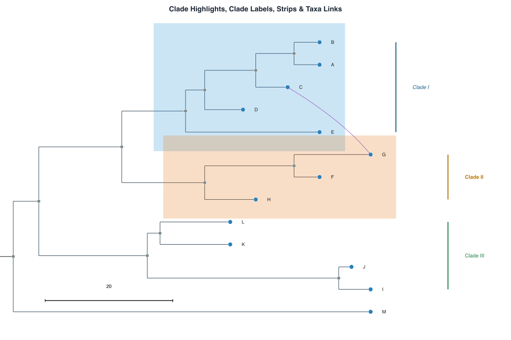

Clade highlights (`geom_hilight`) vs sibling-clade balance bands (`geom_balance`):

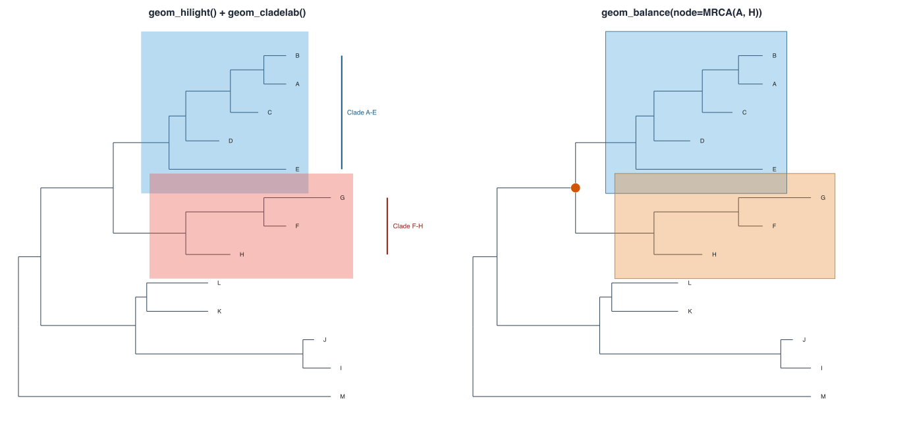

Taxa strips (`geom_strip`) and pairwise curved links (`geom_taxalink`) in rectangular and circular layouts:

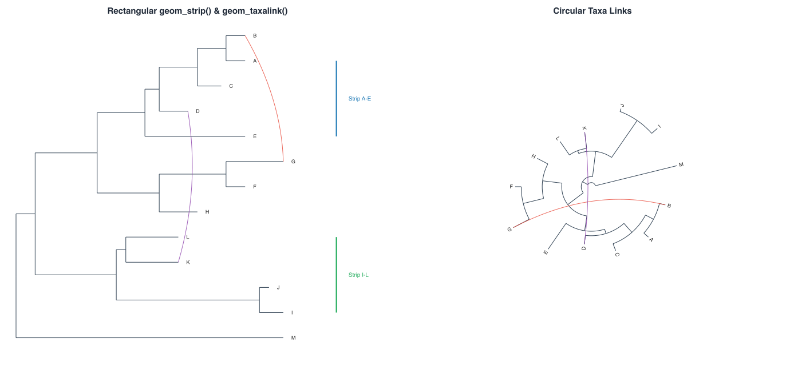

---

## 2. Aligned Heatmaps & Sequences (`gheatmap`, `msaplot`, `new_scale_fill`)

### `gheatmap()`

Appends a matrix/DataFrame heatmap aligned row-for-row with tree tips (works in both rectangular and circular/polar layouts):

```python
p_hm = gg.gheatmap(
    p_tree,
    genotype_df,
    offset=6.5,
    width=0.55,
    font_size=2.8,
    colnames_angle=-45,
    hjust=0.0,
)
```

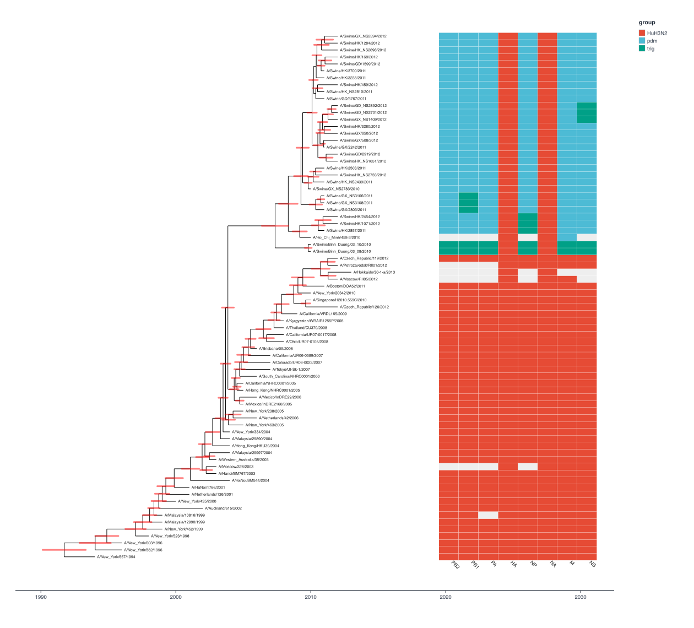

- Column positions can be inspected with `get_heatmap_column_position(p_hm, by="bottom")`.
- Missing values (`NA`, `None`, `""`) are handled cleanly.

### Multiple Fill/Color Scales (`new_scale_fill()`, `new_scale_color()`)

Track independent color/fill legends across stacked `gheatmap()` calls:

```python
p1 = gg.gheatmap(base, df_cat, offset=0.55, width=0.28) + gg.scale_fill_viridis_d(option="D") + gg.new_scale_fill()
p2 = gg.gheatmap(p1, df_num, offset=2.05, width=0.28) + gg.scale_fill_viridis_c(option="A")
```

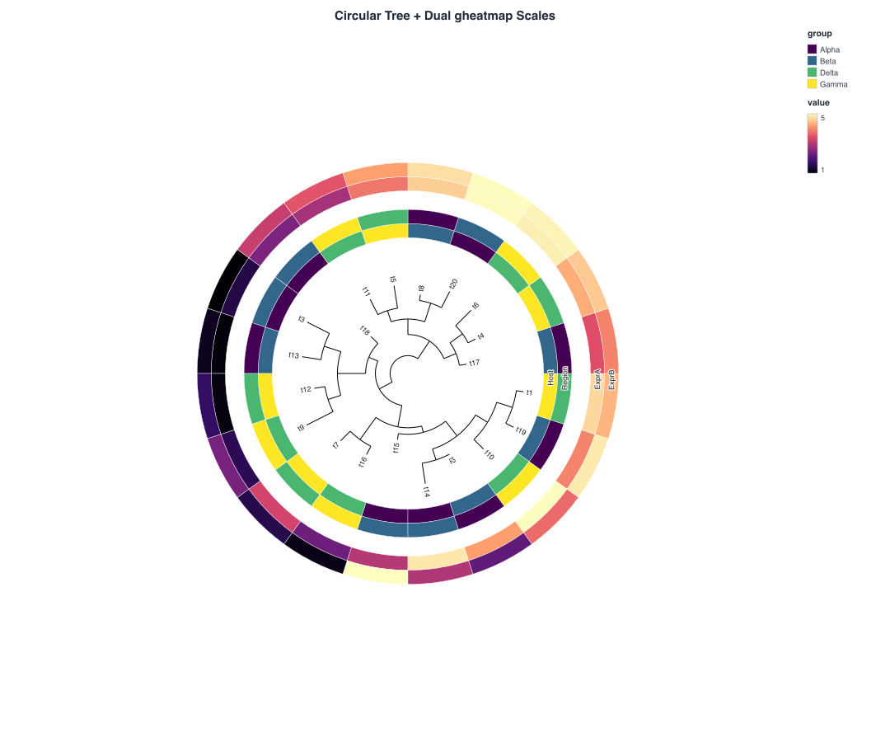

Supported continuous & discrete palettes:
- `scale_fill_viridis_c` / `scale_fill_viridis_d` / `scale_color_viridis_c` / `scale_color_viridis_d` (options `"D"`, `"A"`, `"B"`, `"C"`, `"E"`)
- `scale_fill_gradient`, `scale_fill_gradient2`, `scale_fill_continuous`, `scale_fill_brewer`, `scale_fill_manual` (and matching `scale_color_*` / `scale_colour_*`)

### `msaplot()`

Aligns a FASTA sequence alignment next to a tree:

```python
p_msa = gg.msaplot(
    gg.ggtree(pa_tree) + gg.geom_tiplab(size=2.8),
    fasta=gg.system_file("extdata/pa.fas", package="ggtree"),
    window=(1, 60),
    offset=0.014,
    width=1.35,
)
```

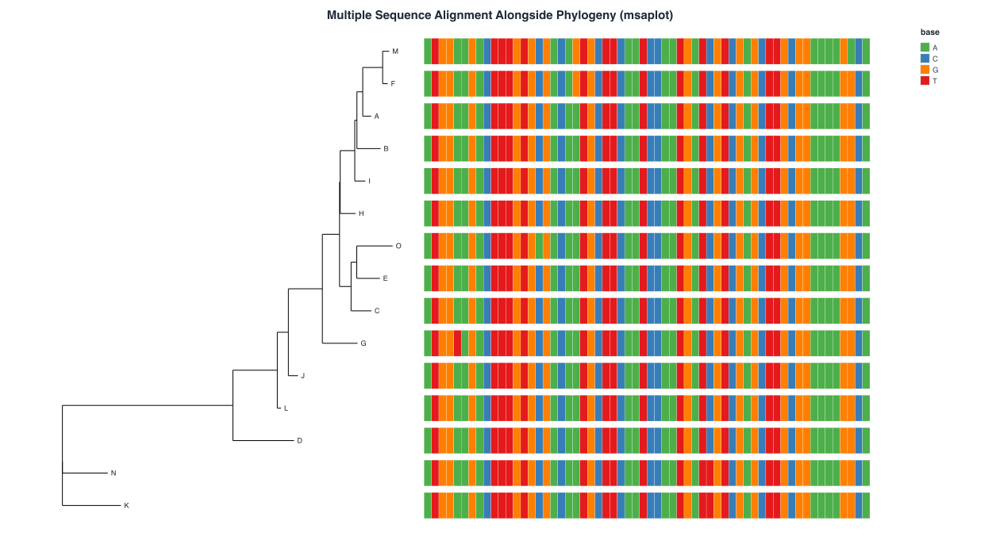

---

## 3. Faceted Data Panels (`geom_facet` / `facet_plot`)

Attach arbitrary ggplot-style panels synchronized by tip `y` coordinate alongside the `"Tree"` panel:

```python
p_facet = (
    gg.ggtree(tr)
    + gg.geom_tiplab()
    + gg.geom_facet(panel="Trait", data=trait_df, geom=gg.geom_point, mapping=gg.aes(x="value", color="group"))
    + gg.scale_color_manual(values={"High": "#E74C3C", "Low": "#2980B9"})
    + gg.theme_bw()
)
p_facet = gg.facet_widths(p_facet, widths=[1.1, 1.3])
p_facet = gg.facet_labeller(p_facet, {"Tree": "Phylogeny", "Trait": "Continuous Trait"})
```

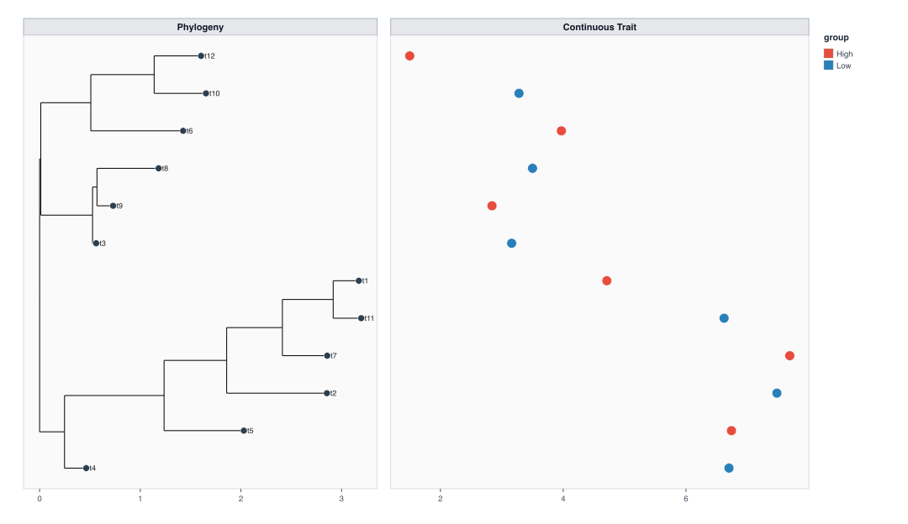

Multiple data panels can be stacked side by side with shared discrete scales (`geom_col` bar panel + `geom_segment` / `geom_point` Cleveland dot plot):

```python
p_multi = (
    gg.ggtree(tr)
    + gg.geom_tiplab()
    + gg.geom_facet(panel="Abundance", data=ab_df, geom=gg.geom_col, mapping=gg.aes(x="abundance", fill="habitat"))
    + gg.geom_facet(panel="Trait", data=tr_df, geom=gg.geom_segment, mapping=gg.aes(x="trait_x0", xend="trait_val", y="y", yend="y"))
    + gg.geom_facet(panel="Trait", data=tr_df, geom=gg.geom_point, mapping=gg.aes(x="trait_val", color="habitat"))
    + gg.theme_bw()
)
p_multi = gg.facet_widths(p_multi, widths=[1.1, 0.9, 0.9])
```

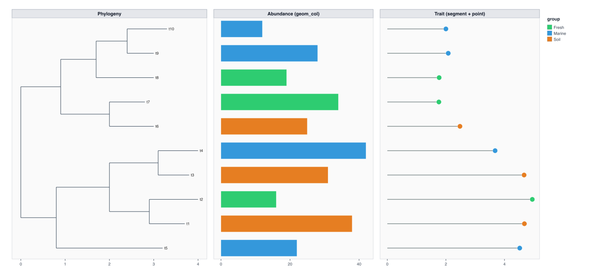

- Retrieve panel data via `facet_data(p_facet, "Trait")`.
- Supported panel geoms include `geom_point`, `geom_tile`, `geom_bar`, `geom_col`, `geom_boxplot`, `geom_violin`, `geom_density`, `geom_histogram`, `geom_segment`, `geom_line`, `geom_errorbar`, and `geom_text`.

---

## 4. Node Pie/Bar Insets (`nodepie`, `nodebar`, `inset`)

Overlay pie charts or bar charts at internal/tip nodes:

```python
anc_df = gg.DataFrame({
    "node": [11, 12, 13, 14, 15],
    "State_A": [0.29, 0.43, 0.57, 0.71, 0.15],
    "State_B": [0.41, 0.27, 0.13, 0.14, 0.55],
    "State_C": [0.30, 0.30, 0.30, 0.15, 0.30],
})
pies = gg.nodepie(anc_df, cols=["State_A", "State_B", "State_C"])
p_pie = gg.inset(gg.ggtree(tr) + gg.geom_tiplab(), pies, width=0.11, height=0.11)
```

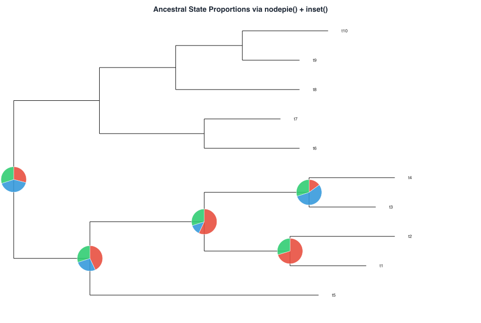

`nodebar(data, cols=..., color=None, alpha=1.0, position="stack")` provides stacked (`position="stack"`) or grouped (`position="dodge"`) bar insets:

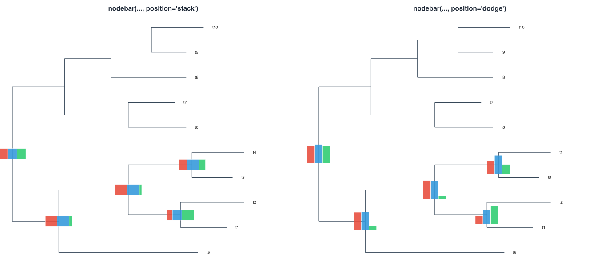

---

## 5. Multi-Tree Plots & Tanglegrams

### `ggdensitree()`

Overlays an ensemble of `MultiPhylo` / `TreeDataList` trees (`tip_order="mode"`, `align_tips=True`, `alpha`, `colour`):

```python
trees = gg.read_tree(gg.system_file("extdata", "ggdensitree_example.tree", package="ggtree"))
p_dens = gg.ggdensitree(trees, alpha=0.28, colour="steelblue") + gg.geom_tiplab(size=2.5) + gg.hexpand(0.32)
```

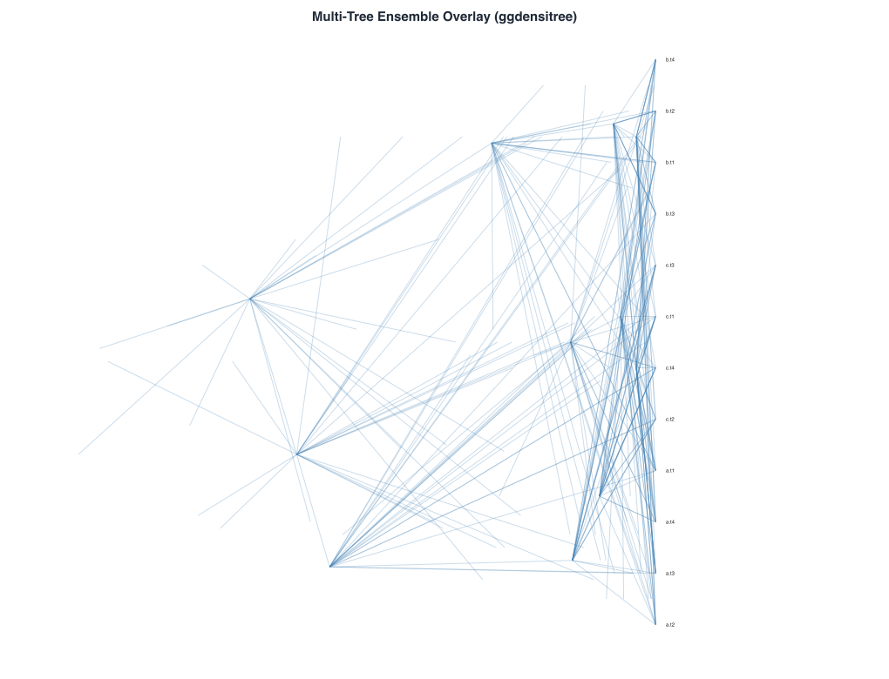

### `as_tanglegram()` & `ggdoubletree()`

Align two trees face-to-face with optional iterative crossing minimization (`optimize=True`, `optimize_side="left" | "right" | "both"`) and cubic Bezier association curves:

```python
p_tg = gg.ggdoubletree(
    gg.ggtree(t1) + gg.geom_tiplab(),
    gg.ggtree(t2) + gg.geom_tiplab(),
    assoc=assoc_df,
    gap=0.22,
    optimize=True,
    optimize_side="both",
    link_color="#2980B9",
)
```

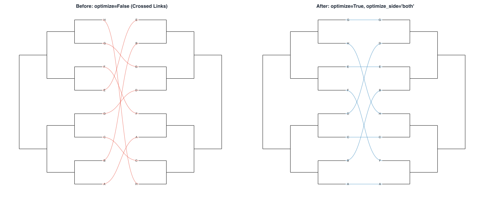

### Multi-Panel Grids (`multiplot`, `plot_list`, `|`, `/`)

- `multiplot(p1, p2, p3, ncol=3, labels=["A", "B", "C"])` or `plot_list(*plots, ncol=..., nrow=..., widths=..., heights=..., tag_levels="A")`:

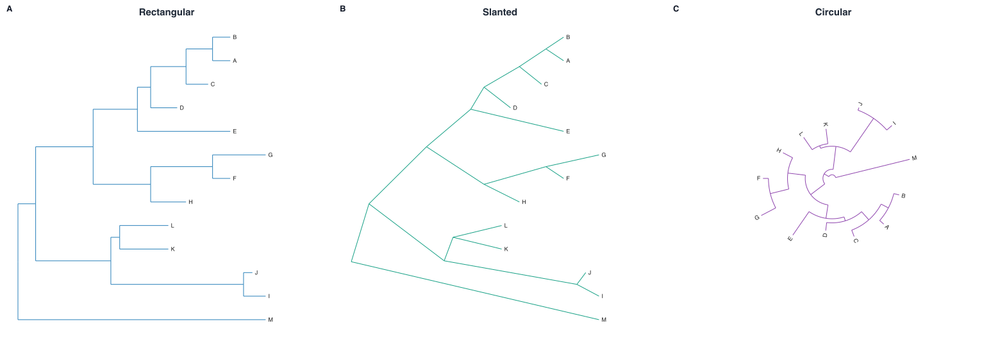

- Nested patchwork operators: `(p_rect | p_circ) / p_bot` builds a 2-column top row above a full-width bottom plot:

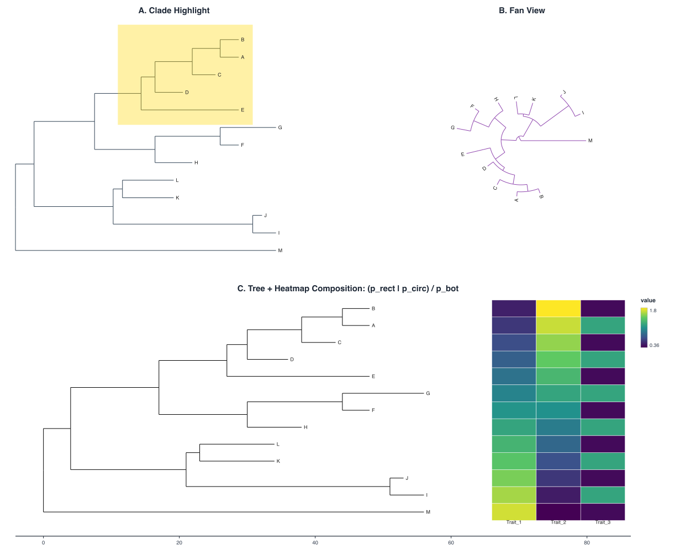
