# Visual Gallery (`ggtree-py`)

> **Navigation:** [Docs Home](index.md) · [Online Book](https://zhanxw.github.io/ggtree-py-book/) · [Visual Gallery](gallery.md) · [Getting Started](getting_started.md) · [Layouts & Manipulation](layouts_and_manipulation.md) · [Annotations & Compositions](annotations_and_compositions.md) · [API Reference](api_reference.md) · [R-to-Python Migration](r_to_python_migration.md) · [GitHub](https://github.com/zhanxw/ggtree-py) · [PyPI](https://pypi.org/project/ggtree-py/)

> 📖 **Interactive Online Book Edition:** Browse all **111 reproducible `treedata-book` figures** with live search, Part/Chapter filters, Master Index Table, and collapsible Python code in the **[Online Book Gallery](https://zhanxw.github.io/ggtree-py-book/gallery.html)** or start from **[Book Home](https://zhanxw.github.io/ggtree-py-book/)**.

All 28 rendered outputs below were generated directly by `ggtree-py` using [`docs/generate_doc_figures.py`](https://github.com/zhanxw/ggtree-py/blob/main/docs/generate_doc_figures.py) (`dpi=120`).

---

## 1. Core Tree Inputs, Metadata & Themes

See **[Getting Started & Tree Data I/O](getting_started.md)** for full code examples.

### Basic Tree Structures (`read_tree`, `branch_length="none"`, `hclust`)
*Phylogram, equal-branch cladogram, and average-linkage hierarchical clustering dendrogram rendered side by side with `|`.*

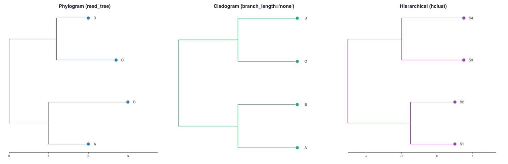

### Attaching Metadata via `%` (`p % df`)
*Left-joining external sample scores and groups onto tree nodes maps point size (`aes(size="score")`) and discrete Brewer colors (`scale_color_brewer`).*

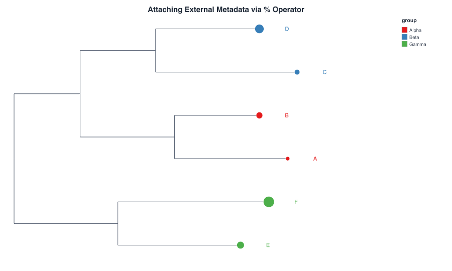

### Table Filtering & Label Formatting (`td_filter`, `td_mutate`, `label_pad`)
*Selecting tips vs internal nodes dynamically inside layer `data=` callables and right-justifying labels with `label_pad()`.*

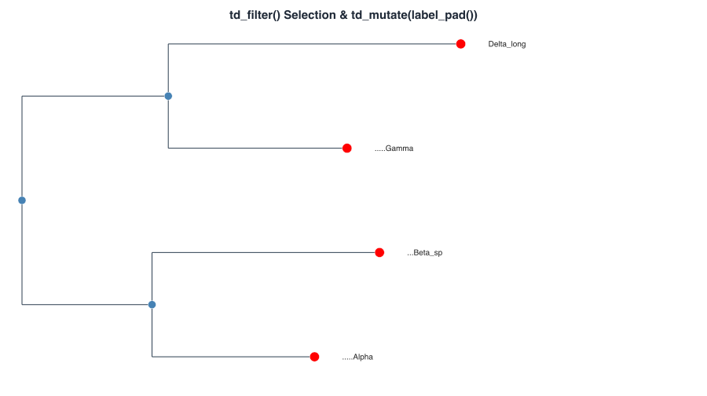

### Symbolic Aesthetics & Branch Subsetting (`~isTip`, `node`, `branch`)
*Unquoted R-compatible expressions highlight internal node IDs and annotate non-zero branch lengths along horizontal midpoints.*

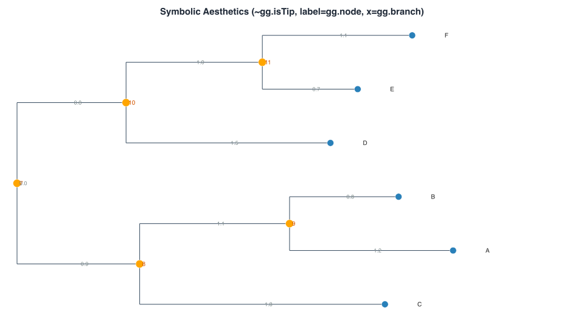

### Built-In Plot Themes (`theme_tree`, `theme_tree2`, `theme_bw`, `theme_minimal`)
*Switching cleanly between blank phylogenetic canvases, evolutionary x-axis rulers, framed grids, and minimal borderless grids.*

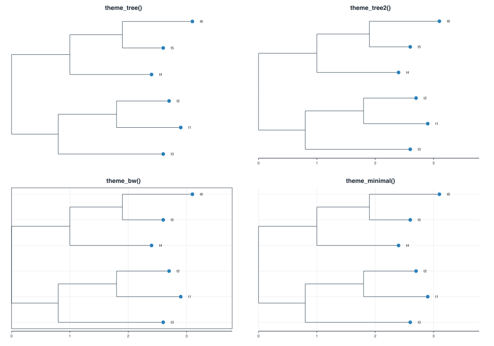

---

## 2. Phylogenetic Layouts & Timescales

See **[Layouts & Tree Manipulation](layouts_and_manipulation.md)** for details.

### All 12+ Phylogenetic Layouts (`ggtree(..., layout=...)`)
*Twelve built-in layouts: `rectangular`, `roundrect`, `slanted`, `ellipse`, `circular`, `fan`, `inward_circular`, `radial`, `dendrogram`, `equal_angle`, `daylight`, and `ape`.*

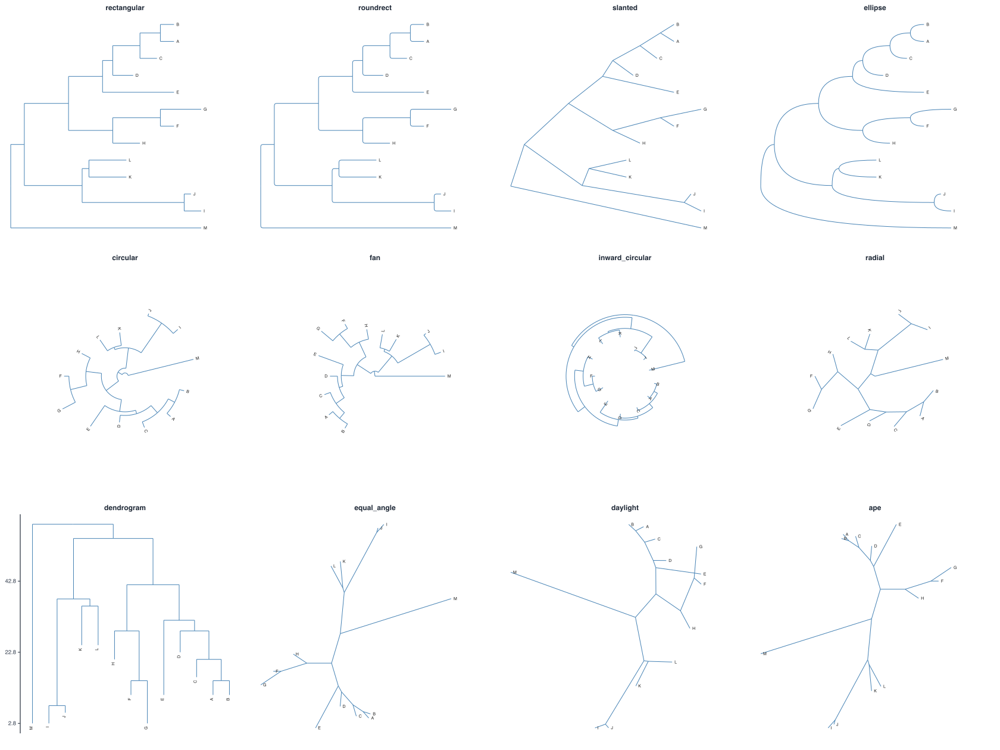

### Circular Opening & Rotation (`open_tree`, `rotate_tree`)
*Progressive transformation from closed `circular` (`360°`) to `90°` fan gap via `open_tree()`, followed by `45°` counter-clockwise rotation via `rotate_tree()`.*

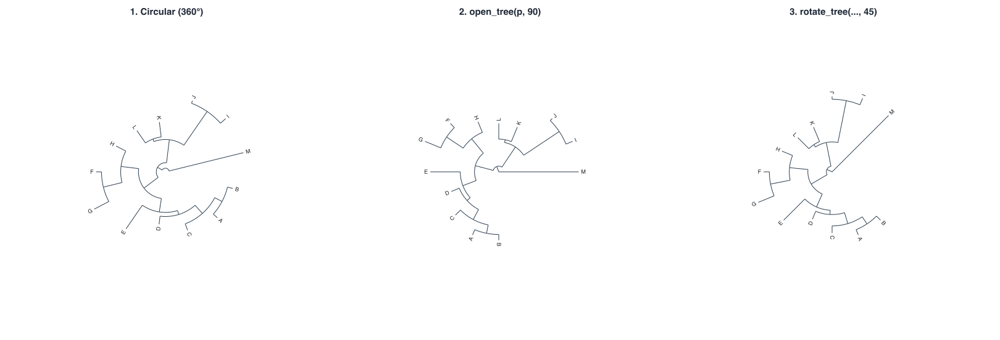

### Dendrogram Layouts (`layout="dendrogram"`, `hclust`, `theme_dendrogram`)
*Vertical top-to-bottom dendrograms for clade-grouped phylogenies and distance-matrix hierarchical clusters.*

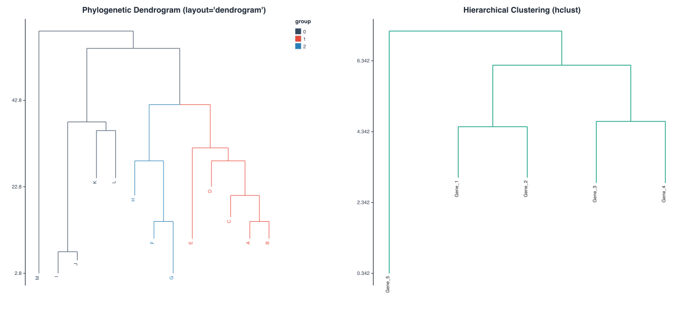

### Time-Scaled FluA H3 Trees (`mrsd` & `revts`)
*Calibrating branch coordinates to calendar years (`mrsd="2013-01-01"`) vs reversed time-before-present (`revts() + scale_x_continuous(labels=abs)`).*

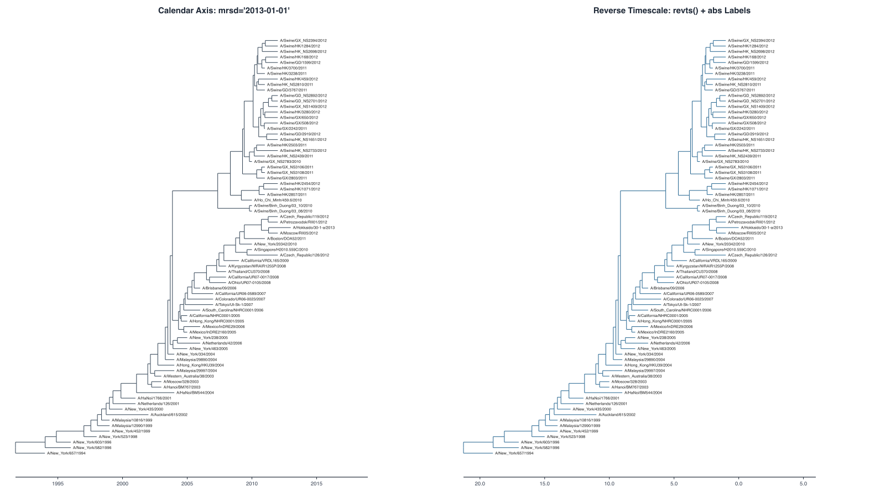

---

## 3. Clade Grouping & Tree Manipulation

See **[Layouts & Tree Manipulation](layouts_and_manipulation.md#3-clade-selection-grouping--tree-manipulation)** for API notes.

### Grouping Clades & Taxa (`groupClade`, `groupOTU`)
*Coloring monophyletic clades (`groupClade`) vs polyphyletic tip groups and connecting ancestor lineages (`groupOTU`).*

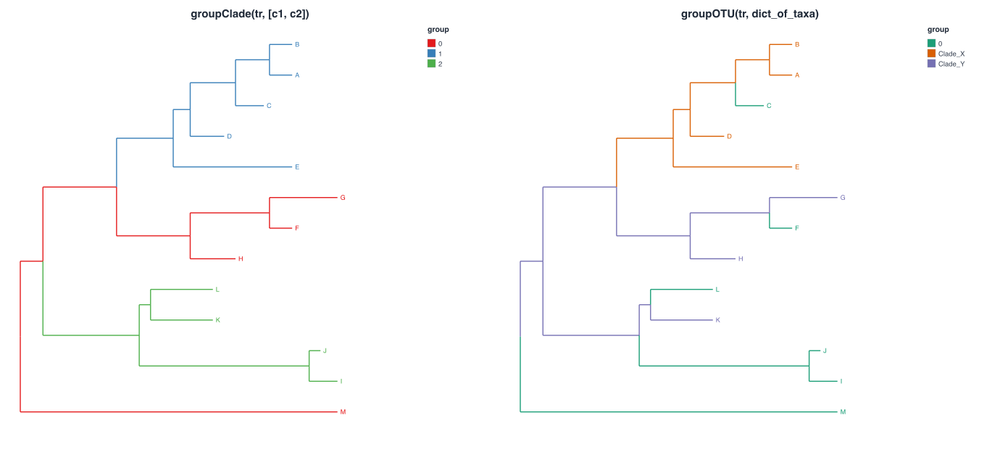

### Collapsing & Expanding Clades (`collapse`, `expand`)
*Comparing `mode="mixed"`, `"max"`, and `"min"` triangle styles alongside live clade restoration via `expand()`.*

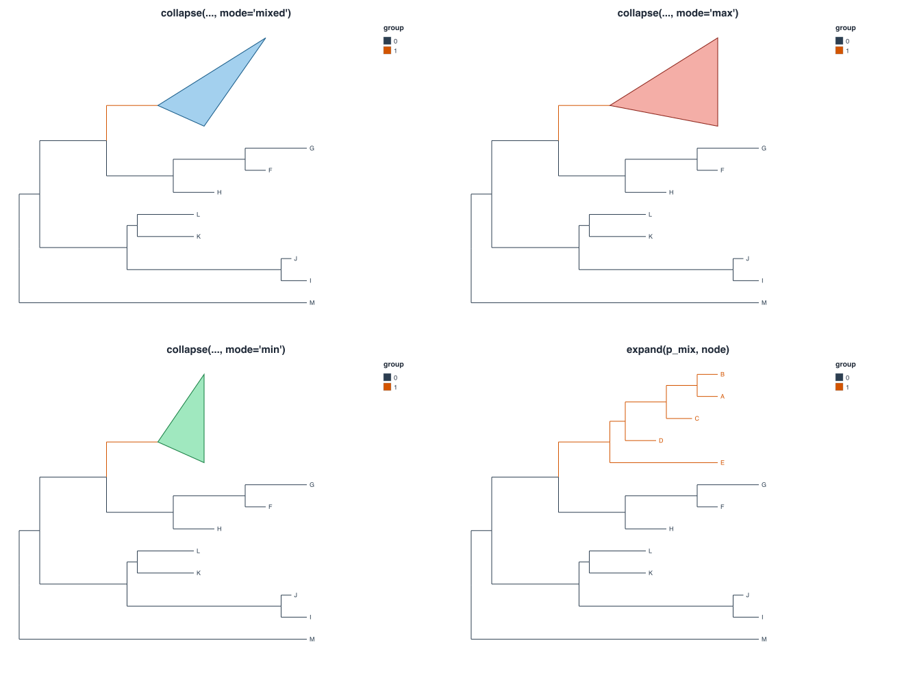

### Rotating, Flipping & Rescaling Clades (`rotate`, `flip`, `scaleClade`)
*Reordering child branches (`rotate`), swapping two sibling clades vertically (`flip`), and compressing vertical clade spacing (`scaleClade`).*

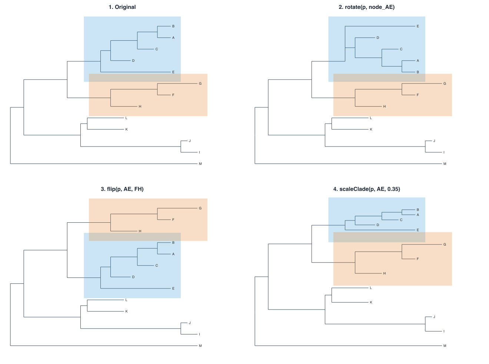

### Focusing & Zooming Clades (`viewClade`, `gzoom`)
*Zooming viewport bounds directly onto a clade (`viewClade`) or displaying synchronized overview + focal panes (`gzoom`).*

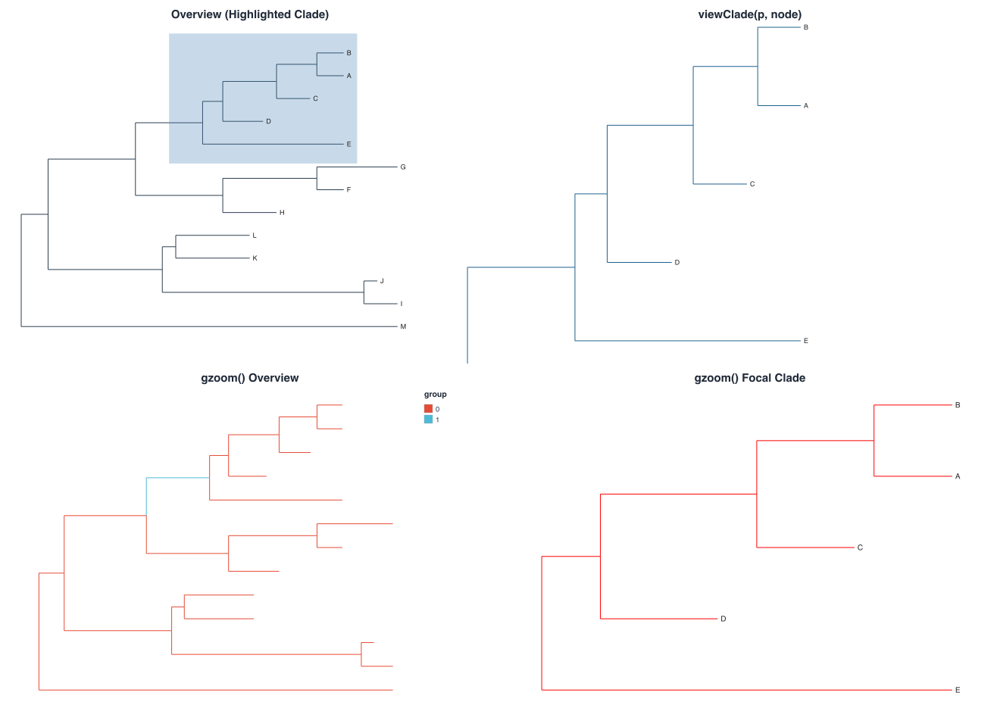

### Collapsing Weak Branches to Polytomies (`as_polytomy`)
*Converting internal edges below bootstrap support `< 70` in `RAxML_bipartitions.H3` into clean polytomies.*

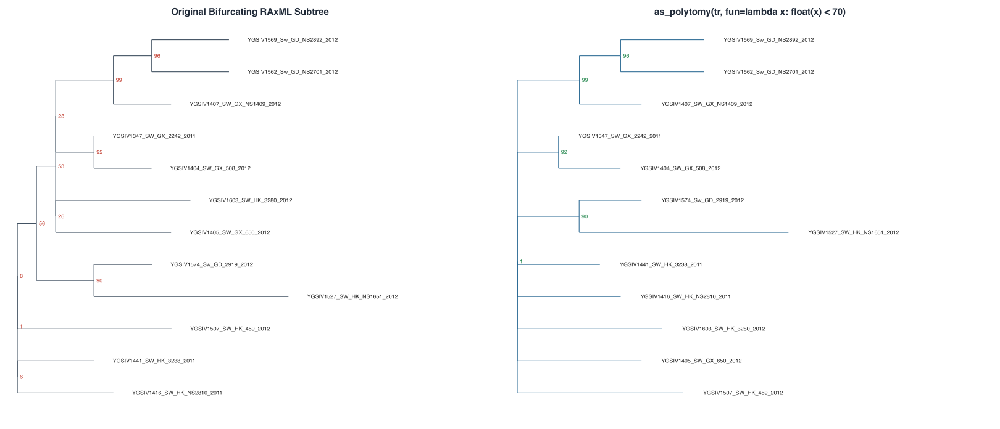

---

## 4. Annotations, Heatmaps & Sequence Alignments

See **[Annotations, Heatmaps, Facets & Multi-Tree Compositions](annotations_and_compositions.md)** for full recipes.

### Clade Highlights, Labels, Strips & Links (`geom_hilight`, `geom_cladelab`, `geom_strip`, `geom_taxalink`, `geom_treescale`)
*Combined annotation layers featuring `parse=True` plotmath formatting (`italic(...)`, `bold(...)`), root stem, and evolutionary distance bar.*

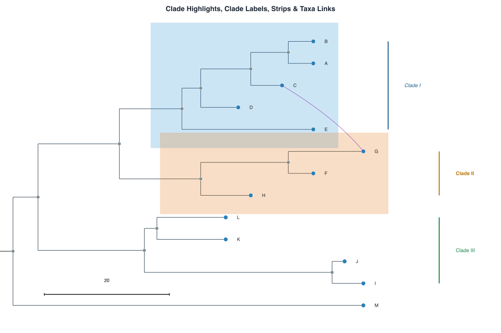

### Clade Highlights vs Sibling Balance (`geom_hilight`, `geom_balance`)
*Comparing single-clade rectangular highlights with two-color sibling subclade balance boxes beneath `MRCA("A", "H")`.*

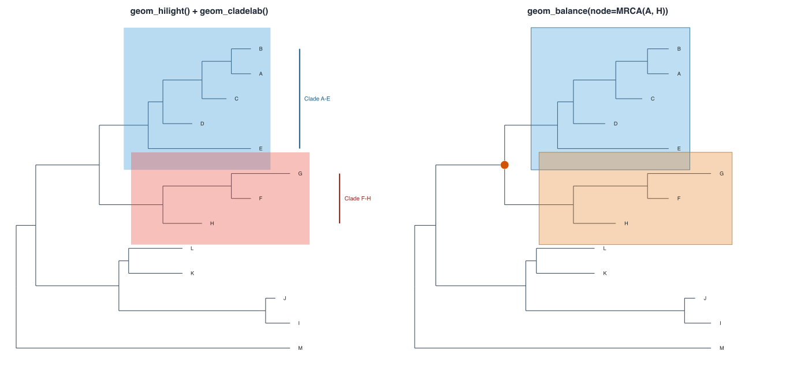

### Span Strips & Curved Taxa Links (`geom_strip`, `geom_taxalink`)
*Annotation strips between non-monophyletic taxa bounds and Bezier curves connecting pairs across rectangular and circular trees.*

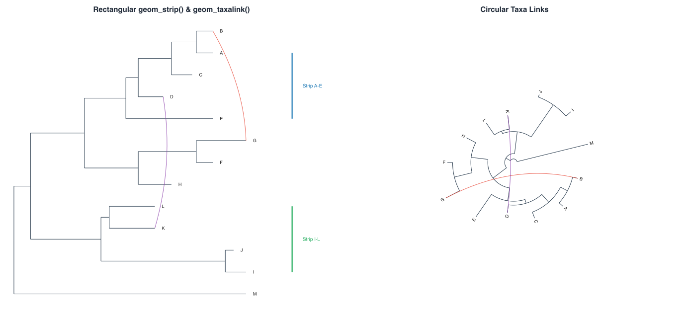

### BEAST Time Tree + Uncertainty Bars + Genotype Matrix (`read_beast`, `geom_range`, `gheatmap`)
*95% HPD posterior uncertainty bars overlaid on FluA H3 nodes beside an 8-segment viral genotype heatmap (`Genotype.txt`).*

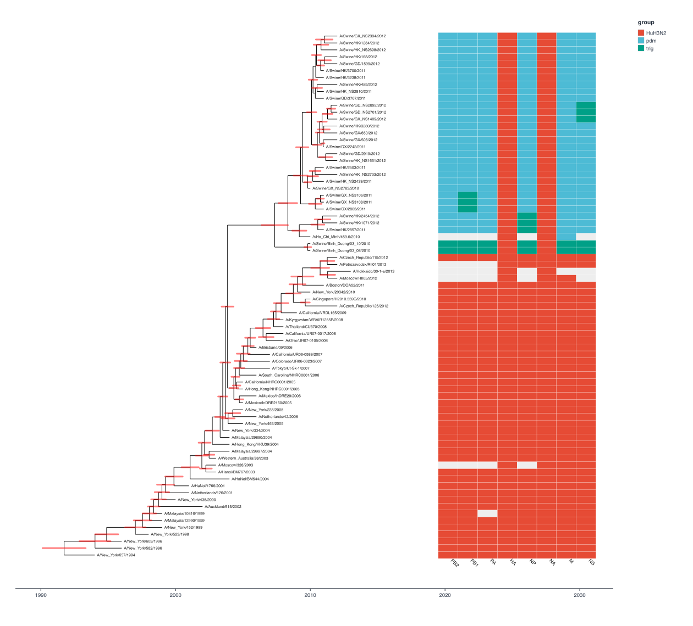

### Circular Tree with Multiple Fill Scales (`new_scale_fill`, `scale_fill_viridis_d`, `scale_fill_viridis_c`)
*Concentric categorical (`option="D"`) and continuous (`option="A"`) heatmap rings around a polar tree with independent legends.*

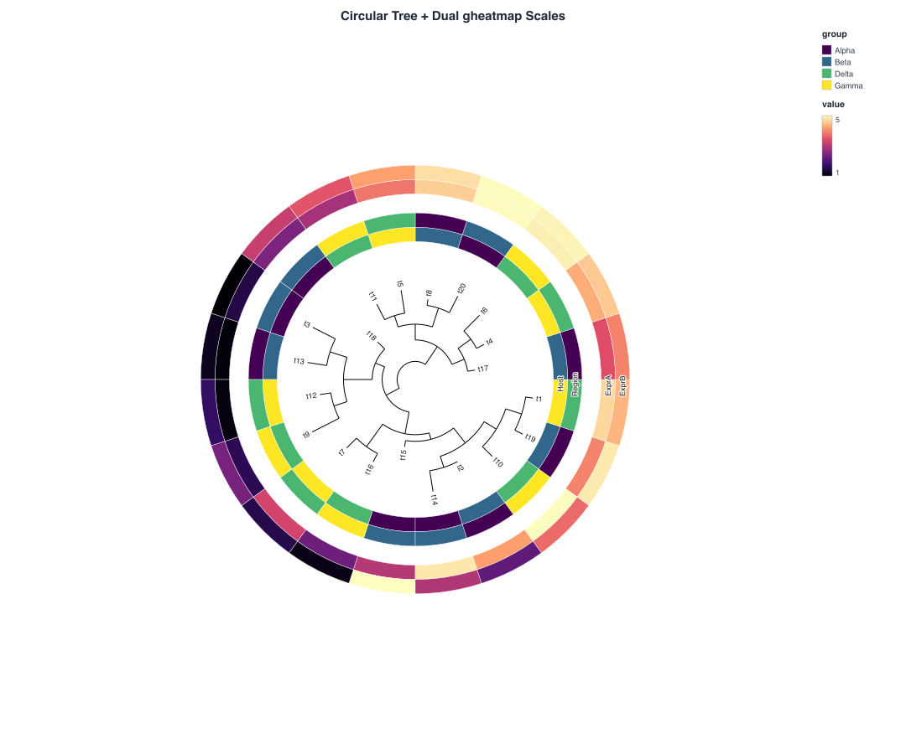

### Phylogeny + Multiple Sequence Alignment (`msaplot`)
*Aligned amino-acid/nucleotide FASTA sequences (`pa.nwk` + `pa.fas`, sites `1..60`) synchronized row-by-row with tip order.*

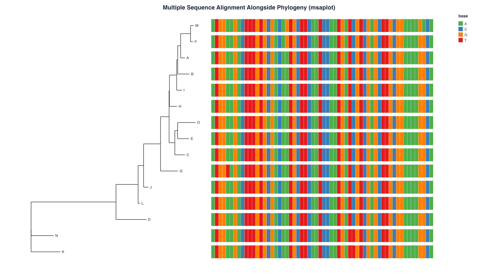

---

## 5. Facets, Node Insets & Multi-Tree Compositions

See **[Annotations & Compositions](annotations_and_compositions.md#3-faceted-data-panels-geom_facet--facet_plot)** for usage details.

### Single Trait Facet Panel (`geom_facet`, `facet_widths`, `facet_labeller`)
*Synchronizing an external continuous trait scatter panel row-by-row with phylogenetic tips.*

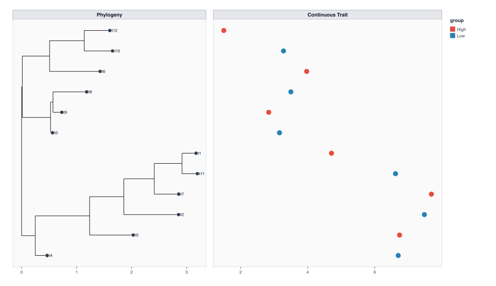

### Multi-Panel Facets (`geom_col`, `geom_segment`, `geom_point`)
*Three aligned panels displaying phylogeny, habitat abundance bars (`geom_col`), and trait lollipops (`geom_segment` + `geom_point`) with a unified legend.*

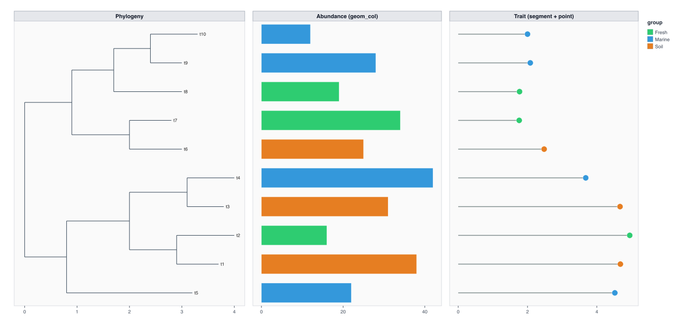

### Ancestral State Pie Insets (`nodepie`, `inset`)
*Overlaying discrete ancestral state proportion pie charts directly onto internal tree nodes.*

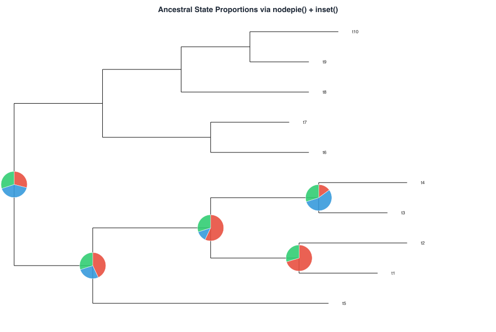

### Stacked vs Dodged Node Bar Insets (`nodebar`, `inset`)
*Comparing stacked proportion bars (`position="stack"`) and grouped multi-series bars (`position="dodge"`) anchored at internal nodes.*

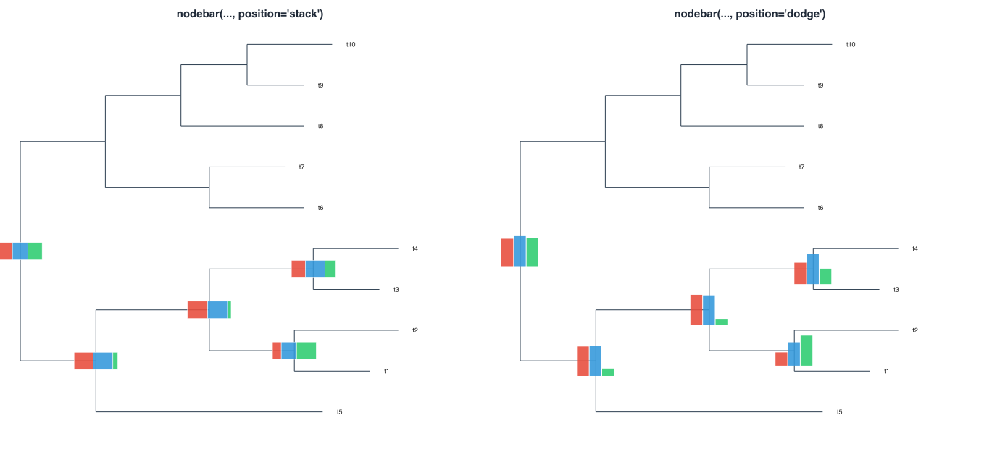

### Multi-Tree Ensemble Overlay (`ggdensitree`)
*Visualizing topological uncertainty across a `MultiPhylo` posterior sample with aligned tip consensus order.*

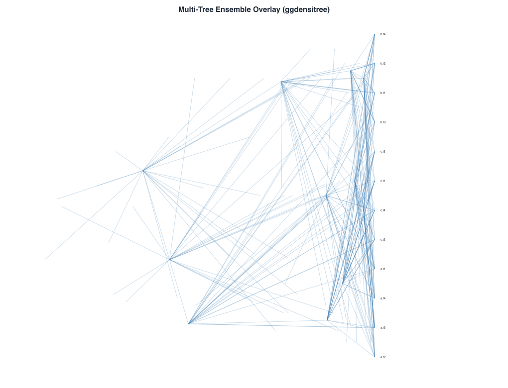

### Tanglegram Layout & Crossing Optimization (`ggdoubletree`)
*Comparing raw face-to-face tree tip crossings (`optimize=False`) against bidirectional untangling (`optimize=True, optimize_side="both"`).*

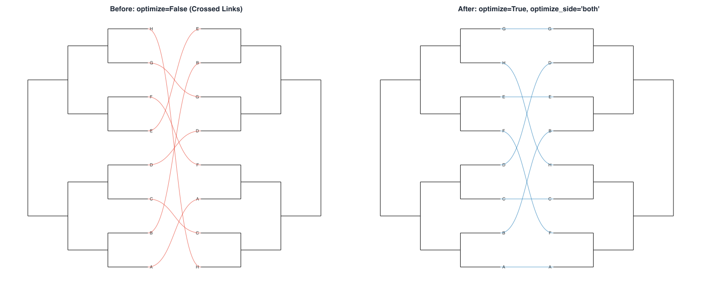

### Multi-Panel Grid Layout (`multiplot`)
*Arranging rectangular, slanted, and circular views in an indexed multi-column grid (`labels=["A", "B", "C"]`).*

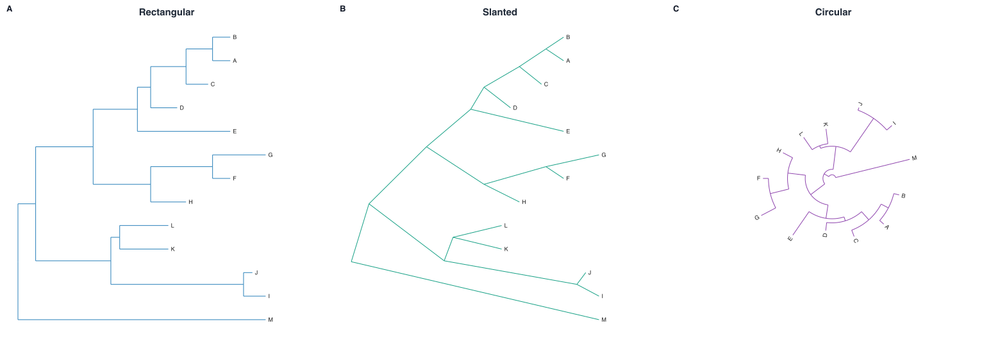

### Nested Patchwork Composition (`|` and `/`)
*Declarative composite figures built via `(p_rect | p_circ) / p_bot`, combining top-row panels over a full-width heatmap view.*

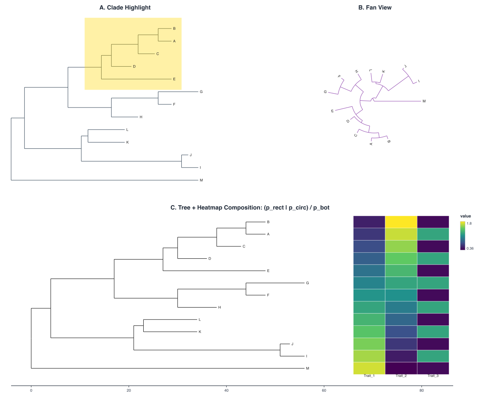
