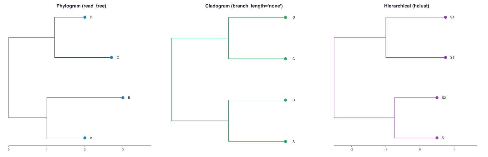
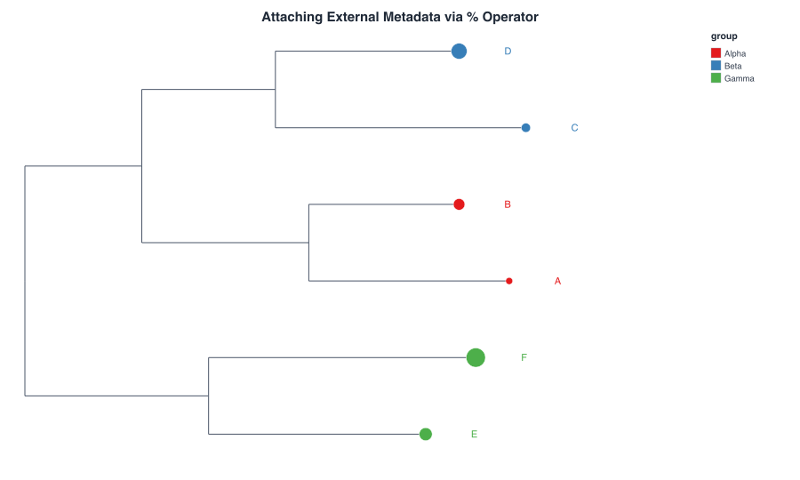
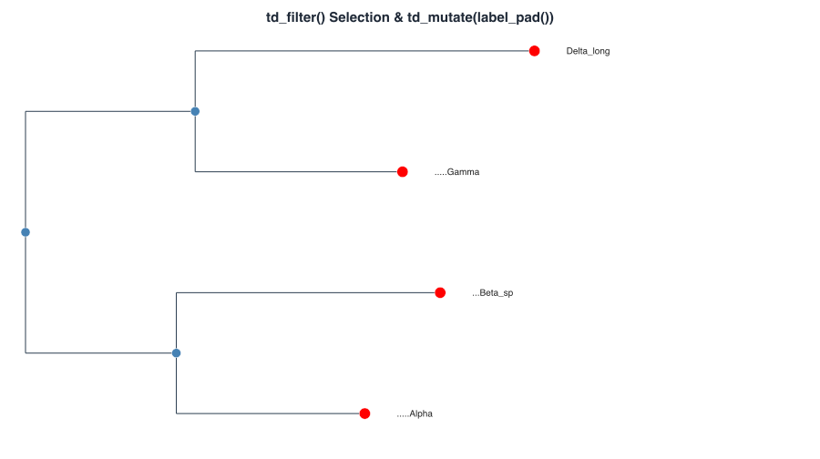
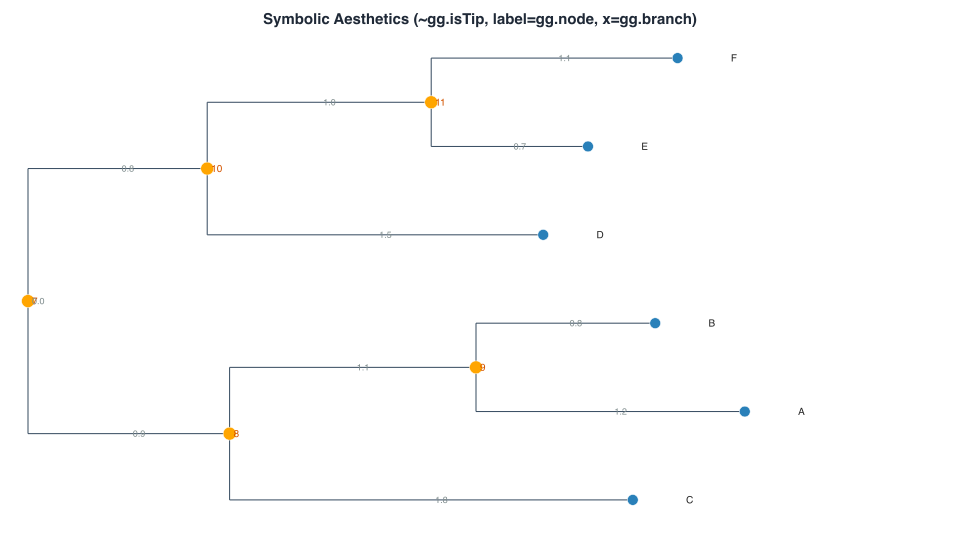
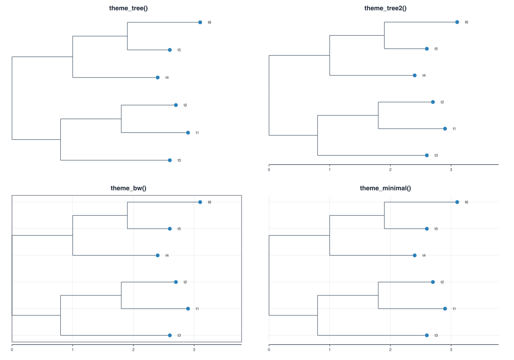

# Getting Started & Tree Data I/O

> **Navigation:** [Docs Home](index.md) · [Online Book](https://zhanxw.github.io/ggtree-py-book/) · [Visual Gallery](gallery.md) · [Getting Started](getting_started.md) · [Layouts & Manipulation](layouts_and_manipulation.md) · [Annotations & Compositions](annotations_and_compositions.md) · [API Reference](api_reference.md) · [R-to-Python Migration](r_to_python_migration.md) · [GitHub](https://github.com/zhanxw/ggtree-py) · [PyPI](https://pypi.org/project/ggtree-py/)

## 1. Reading & Creating Trees (`ggtree.tree`)

`ggtree` parses standard phylogenetic file formats and strings without external dependencies:

| Function | Format | Return Type |
| --- | --- | --- |
| `read_tree(file=None, text=None, ...)` | Newick / NEXUS trees | `Phylo` or `MultiPhylo` |
| `read_beast(file)` | BEAST annotated NEXUS (`[&height_95%_HPD=...]`, `posterior`, `rate`, ...) | `TreeData` or `TreeDataList` |
| `read_nhx(file=None, text=None)` | New Hampshire eXtended (`[&&NHX:...]`) | `TreeData` |
| `read_jplace(file)` | Evolutionary placement JSON (`.jplace`) | `TreeData` |
| `read_fasta(file)` | FASTA nucleotide / amino-acid alignment | `Dict[str, str]` |
| `write_tree(phy, file=None)` | Newick serializer | `str` |
| `rtree(n)` / `rmtree(N, n)` / `stree(n)` | Random & star/balanced trees (ported from `ape`) | `Phylo` / `MultiPhylo` |
| `hclust(d, method="complete", labels=None)` | Hierarchical clustering dendrograms (`as_phylo` supported) | `Hclust` |

Bundled sample datasets mirror `system.file(..., package="ggtree" / "treeio")`:

```python
import ggtree as gg

nwk = gg.system_file("extdata", "sample.nwk", package="treeio")
tr = gg.read_tree(nwk)

beast_tr = gg.read_beast(gg.system_file("extdata/MCC_FluA_H3.tree", package="ggtree"))
raxml_tr = gg.read_tree(gg.system_file("extdata/RAxML", "RAxML_bipartitions.H3", package="treeio"))
```

### Tree Inspection & Tidytree Conversion

- `Ntip(tr)`, `Nnode(tr)`, `Nnode2(tr)`, `is_rooted(tr)`, `get_tree(tr)`, `get_seqs(tr)`
- `as_phylo(x)`, `as_treedata(x)`, `as_tibble(x)` -> `TblTree` containing `parent`, `node`, `branch.length`, `label`, and any attached node annotations.
- `fortify(tr, layout="rectangular", ...)` -> `TblTree` with layout coordinates (`x`, `y`, `branch`, `angle`, `isTip`, ...).

Compare phylograms (`read_tree`), cladograms (`branch_length="none"`), and hierarchical clustering trees (`hclust`):

```python
import numpy as np
import ggtree as gg

tr = gg.read_tree(text="((A:1.0,B:2.0):1.0,(C:1.5,D:0.8):1.2);")
p1 = gg.ggtree(tr) + gg.geom_tiplab(offset=0.1) + gg.geom_tippoint(color="#2980B9") + gg.theme_tree2() + gg.hexpand(0.25)
p2 = gg.ggtree(tr, branch_length="none") + gg.geom_tiplab(offset=0.1) + gg.geom_tippoint(color="#27AE60") + gg.hexpand(0.25)

dmat = np.array([
    [0.0, 1.5, 5.0, 5.2],
    [1.5, 0.0, 4.8, 5.1],
    [5.0, 4.8, 0.0, 2.0],
    [5.2, 5.1, 2.0, 0.0],
])
hc = gg.hclust(dmat, method="average", labels=["S1", "S2", "S3", "S4"])
p3 = gg.ggtree(hc) + gg.geom_tiplab(offset=0.1) + gg.geom_tippoint(color="#8E44AD") + gg.theme_tree2() + gg.hexpand(0.28)
p1 | p2 | p3
```



---

## 2. Attaching Metadata & Transforming Tree Data

External annotations (such as sample metadata, traits, or host species) can be attached directly to a `TreeData` object or onto a `GGTree` plot:

### Operator `%` / `<<` / `@` (Port of R `%<+%`)

```python
import ggtree as gg

tr = gg.read_tree(text="(((A:1.2,B:0.9):1.0,(C:1.5,D:1.1):0.8):0.7,(E:1.3,F:1.6):1.1);")
meta = gg.DataFrame({
    "taxa": ["A", "B", "C", "D", "E", "F"],
    "score": [12, 24, 18, 36, 28, 45],
    "group": ["Alpha", "Alpha", "Beta", "Beta", "Gamma", "Gamma"],
})

p = (
    gg.ggtree(tr)
    % meta
    + gg.geom_tiplab(gg.aes(color="group"), offset=0.25)
    + gg.geom_tippoint(gg.aes(size="score", color="group"))
    + gg.scale_color_brewer(palette="Set1")
    + gg.hexpand(0.32)
)
```



- `p % meta` (or `p << meta`, `p @ meta`) joins `meta` onto `p.data` matching the label/taxa column (`taxa`, `label`, or first column).
- `p % new_tree` replaces the tree inside `p` (equivalent to R's `%<%`) while retaining layers and themes.

### Table Joins & Pipeable Verbs (`td_filter`, `td_mutate`, `td_unnest`)

- `left_join(tree, df, by="label")` / `full_join` / `inner_join` return an enriched `TreeData` (when joining onto `Phylo`/`TreeData`) or `DataFrame`.
- `td_filter(...)`, `td_mutate(...)`, and `td_unnest(cols)` create layer `data=` callables matching R's lazy `td_*()` helpers:

```python
p = (
    gg.ggtree(tr)
    + gg.geom_point(data=gg.td_filter("isTip"), color="red", size=3.4)
    + gg.geom_point(data=gg.td_filter("!isTip"), color="steelblue", size=2.8)
    + gg.geom_tiplab(
        data=gg.td_mutate(padded=lambda d: gg.label_pad(d["label"], justify="right", pad=".")),
        mapping=gg.aes(label="padded"),
        offset=0.15,
    )
    + gg.hexpand(0.45)
)
```



---

## 3. Symbolic Aesthetics (`aes`) & Subsetting

`aes(...)` accepts:
- Symbolic column references imported from `ggtree` (`label`, `node`, `branch`, `x`, `y`, `angle`, `group`, `posterior`, `rate`, `height`, `value`, ...)
- Callable subset helpers (`isTip`, `parent`, negated with `~isTip` for `!isTip` internal nodes)
- String column names or expressions (e.g. `aes(color="group")`, `aes(subset="isTip & (node > 3)")`)

```python
p = (
    gg.ggtree(tr)
    + gg.geom_nodepoint(gg.aes(subset=~gg.isTip), color="orange", size=3.6)
    + gg.geom_text2(gg.aes(subset=~gg.isTip, label=gg.node), hjust=-0.65, color="#D35400")
    + gg.geom_tippoint(color="#2980B9", size=3.0)
    + gg.geom_tiplab(offset=0.22)
    + gg.geom_text2(gg.aes(x=gg.branch, label="branch.length", subset="branch.length > 0"), vjust=-0.6, color="#7F8C8D")
    + gg.hexpand(0.25)
)
```



---

## 4. Themes & Axis Styling (`theme_tree`, `theme_tree2`, `theme_bw`, `theme_minimal`)

```python
base = gg.ggtree(tr) + gg.geom_tippoint(color="#2980B9") + gg.geom_tiplab(offset=0.1) + gg.hexpand(0.22)
(base + gg.theme_tree() | base + gg.theme_tree2()) / (base + gg.theme_bw() | base + gg.theme_minimal())
```



---

## 5. Exporting Vector (SVG, PDF), Raster (PNG), & Interactive HTML / Jupyter Figures

- **SVG string**: `svg_text = p.to_svg(width=800, height=600)` (or `_repr_svg_()` for Jupyter notebooks)
- **True PDF vector export**: `pdf_bytes = p.to_pdf(width=800, height=600)` (uses `cairosvg` → `rsvg-convert` → built-in zero-dependency pure-Python `%PDF-1.4` vector compiler)
- **PNG bytes**: `png_data = p.to_png(width=800, height=600)`
- **Interactive HTML & Jupyter (`to_interactive`, `girafe`, `to_html`)**:
  ```python
  iv = p.to_interactive(width=860, height=620, title="Interactive Phylogeny")
  # or: iv = gg.girafe(p, width_svg=8.6, height_svg=6.2)
  iv  # renders interactive iframe widget in Jupyter notebooks
  html_doc = p.to_html(width=860, height=620, interactive=True)
  ```
  Includes wheel/drag pan & zoom, live search across taxon labels and metadata, hover tooltips on tree nodes and `gheatmap`/`facet_plot` tiles/bars, click-to-highlight clades, double-click internal-node collapse toggle, and SVG/PNG download buttons.
- **Save to disk (`ggsave`)**:
  ```python
  gg.ggsave("output.svg", plot=p, width=9.0, height=6.5, dpi=100)
  gg.ggsave("output.png", plot=p, width=9.0, height=6.5, dpi=100)
  gg.ggsave("output.pdf", plot=p, width=9.0, height=6.5)  # or device="pdf"
  gg.ggsave("output.html", plot=p, width=9.0, height=6.5, interactive=True)
  ```
  If no `plot` argument is supplied, `ggsave` uses `last_plot()`. Unsupported file formats raise `ValueError`.

---

## 6. Using pandas, polars, and pyarrow DataFrames

`ggtree-py` keeps `numpy` as its only required runtime dependency while duck-typing popular Python DataFrame libraries (`pandas`, `polars`, `pyarrow.Table`, and `__dataframe__` interchange objects) across `%`, `+`, `gheatmap`, `facet_plot`, `nodepie`/`nodebar`, `geom_*`, `tidytree` helpers, and table conversions:

```python
import pandas as pd
import ggtree as gg

tr = gg.read_tree(gg.system_file("extdata", "sample.nwk", package="treeio"))

# 1. Index-aligned metadata with pd.Categorical and nullable pd.NA values
meta = pd.DataFrame(
    {
        "habitat": pd.Categorical(["Marine", "Freshwater"] * 6 + ["Marine"]),
        "longevity": pd.array([12.0, 28.0, pd.NA, 34.0] * 3 + [16.0], dtype="Float64"),
    },
    index=tr.tip_label,
)

p = (
    gg.ggtree(tr)
    % meta
    + gg.geom_tippoint(gg.aes(color="habitat", size="longevity"))
    + gg.geom_tippoint(
        data=lambda d: d.to_pandas().query("isTip and longevity >= 25"),
        color="gold",
        size=6.0,
        alpha=0.35,
    )
    + gg.geom_tiplab(offset=0.25)
)

# 2. Pass pandas DataFrames directly to gheatmap / facet_plot / export back via .to_pandas()
geno = pd.read_csv(gg.system_file("extdata/Genotype.txt", package="ggtree"), sep="\t", index_col=0)
tbl_pdf = gg.fortify(tr).to_pandas()
```

See the complete runnable showcase in [examples/pandas_example.py](https://github.com/zhanxw/ggtree-py/blob/main/examples/pandas_example.py).

