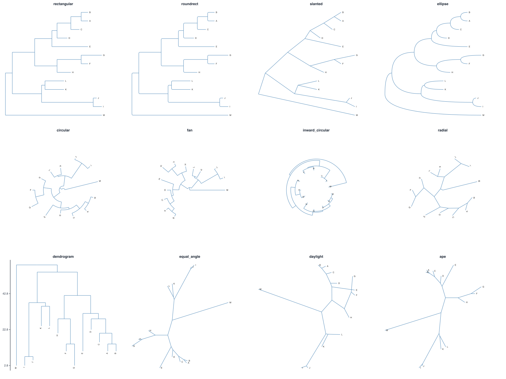
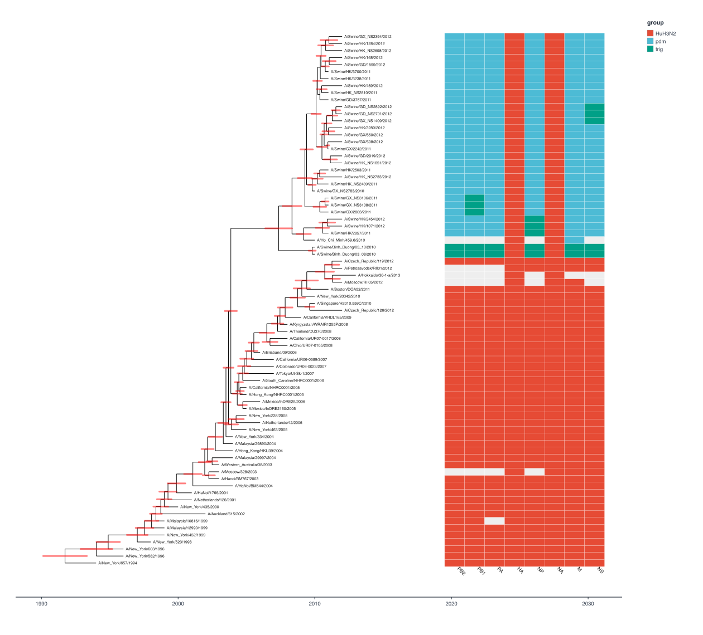
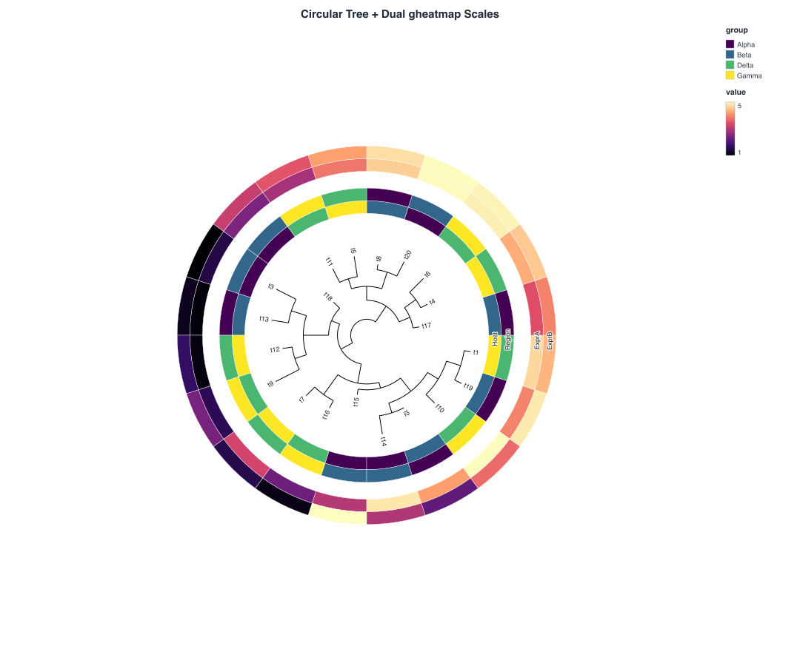
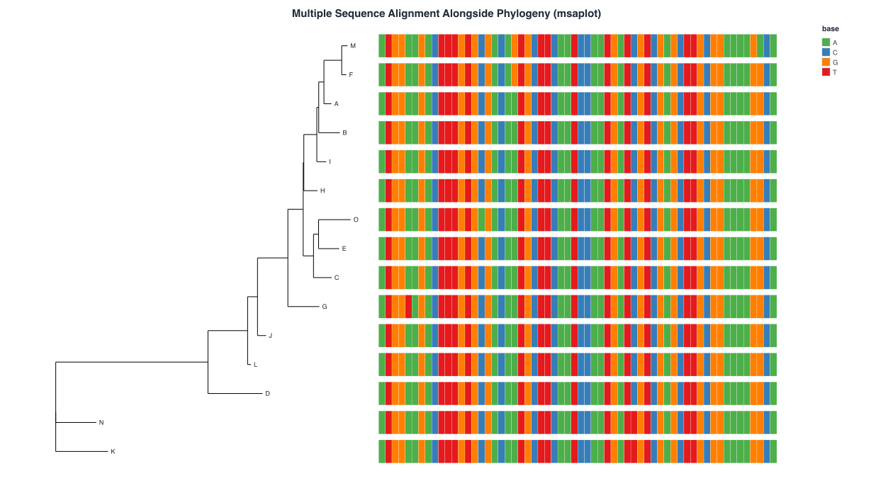
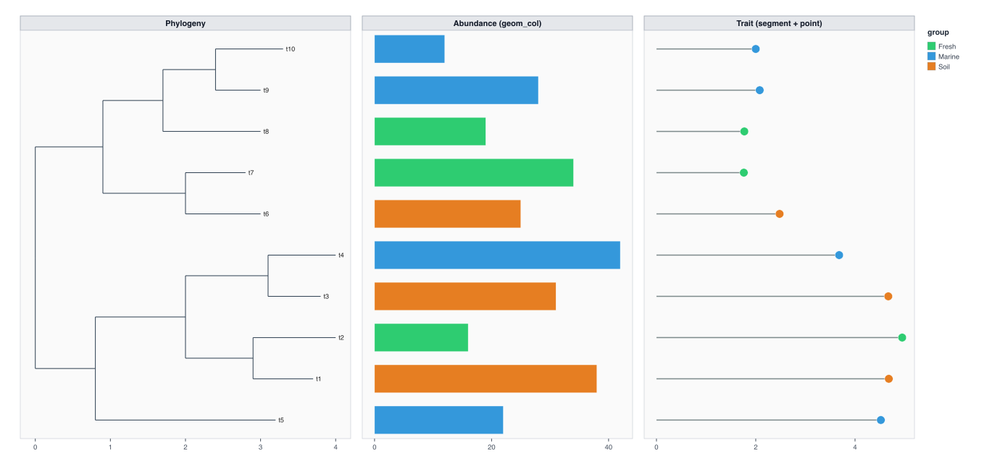
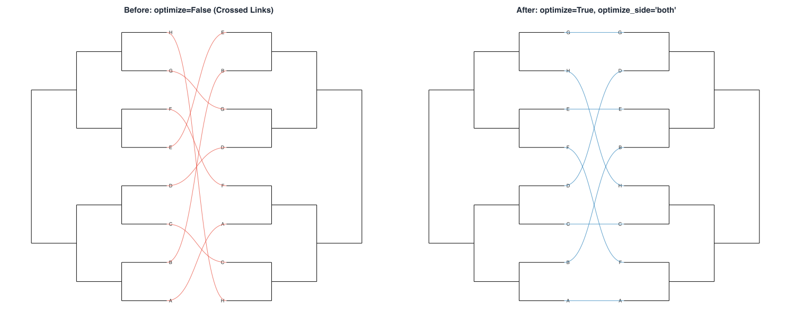

# `ggtree-py` Documentation

Welcome to the documentation for **`ggtree-py`** (`import ggtree`, version `0.1.4`), a Python port of the Bioconductor [`ggtree`](https://github.com/YuLab-SMU/ggtree) package (`4.3.2`) built with Python (`>= 3.10`) and `numpy`.

[**Online Book**](https://zhanxw.github.io/ggtree-py-book/) · [**Book Gallery (111 Figures)**](https://zhanxw.github.io/ggtree-py-book/gallery.html) · [**GitHub Repository**](https://github.com/zhanxw/ggtree-py) · [**PyPI Package**](https://pypi.org/project/ggtree-py/) · [**Visual Gallery (28 Figures)**](gallery.md) · [**Upstream R ggtree**](https://github.com/YuLab-SMU/ggtree)

> 📖 **Online Book (*treedata-book* Python Edition):** Read [**Data Integration, Manipulation and Visualization of Phylogenetic Trees (*ggtree-py* Edition)**](https://zhanxw.github.io/ggtree-py-book/) for the complete 13-chapter book (Parts I–IV, FAQ Appendix A, API Appendix B) with **111 reproducible `ggtree-py` figures**, figure-attached **collapsed-by-default Python code**, and the searchable **[Book Figure Gallery & Master Index](https://zhanxw.github.io/ggtree-py-book/gallery.html)**.

## Visual Tour

Explore the complete visual showcase in the **[Visual Gallery](gallery.md)** (`docs/generate_doc_figures.py`):

| Layouts (`12+ Modes`) | BEAST + `gheatmap()` | Circular + Dual Heatmaps |
| :---: | :---: | :---: |
|  |  |  |
| **`msaplot()` Alignment** | **Multi-Panel `geom_facet()`** | **`ggdoubletree()` Tanglegram** |
|  |  |  |

## Guides

1. **[Getting Started & Tree Data I/O](getting_started.md)** — Reading Newick, BEAST, NHX, jplace, RAxML, FASTA, and hierarchical clustering objects; joining metadata; symbolic aesthetics; themes; SVG/PNG export.
2. **[Layouts & Tree Manipulation](layouts_and_manipulation.md)** — All 12+ phylogenetic tree layouts, polar/fan/dendrogram modifiers, time-scaled MRSD trees (`mrsd`, `revts`), clade selection (`MRCA`, `groupOTU`, `groupClade`), and structural edits (`collapse`, `expand`, `rotate`, `flip`, `scaleClade`, `viewClade`, `zoomClade`, `as_polytomy`).
3. **[Annotations, Heatmaps, Facets & Multi-Tree Compositions](annotations_and_compositions.md)** — Clade labels, highlights, balance bands, strips, taxa links, HPD uncertainty ranges (`geom_range`), aligned heatmaps (`gheatmap`, `new_scale_fill`), sequence alignments (`msaplot`), facet panels (`geom_facet`, `facet_plot`), node insets (`nodepie`, `nodebar`), `ggdensitree`, `ggdoubletree`, and `multiplot` / patchwork (`|`, `/`).
4. **[Visual Gallery (28 Figures)](gallery.md)** — Annotated visual index of all 28 rendered figures organized by workflow and module.
5. **[API Reference](api_reference.md)** — Public functions, classes, and parameter signatures grouped by module.
6. **[R-to-Python Migration Guide](r_to_python_migration.md)** — Side-by-side translation patterns for bringing existing R `ggtree` scripts directly to Python.

## Package Architecture

| Module | Role |
| --- | --- |
| `ggtree.tree` | Tree parsers (`read_tree`, `read_beast`, `read_nhx`, `read_jplace`, `read_fasta`, `write_tree`), structures (`Phylo`, `TreeData`, `MultiPhylo`, `TreeDataList`, `Hclust`), tree generators (`rtree`, `rmtree`, `stree`), and `system_file` |
| `ggtree.tidytree` | Node/taxa traversal (`MRCA`, `offspring`, `ancestor`, `parent`, `child`, `sibling`, `nodeid`, `nodelab`, `taxa2node`), `groupOTU`, `groupClade`, `tree_subset`, `td_filter`, `td_mutate`, `td_unnest` |
| `ggtree.layout` | `fortify` / `tree_layout` coordinate computation for all layouts, `layoutEqualAngle`, `layoutDaylight`, `layoutApe`, `layoutTreeAndLeaf`, `Date2decimal` / `decimal2Date`, `get_clade_position` |
| `ggtree.aes` | Symbolic `Aes`, `SymExpr`, `CallableSymExpr`, expression evaluation (`eval_expr`, `eval_subset`), exported symbols (`isTip`, `parent`, `node`, `label`, `x`, `y`, ...) |
| `ggtree.geoms` | `Layer`, `LayerList`, tree geoms (`geom_tree`, `geom_tiplab`, `geom_nodelab`, `geom_hilight`, `geom_cladelab`, `geom_strip`, `geom_taxalink`, `geom_range`, `geom_treescale`, ...), and interactive geom wrappers |
| `ggtree.manipulate` | `collapse`, `expand`, `rotate`, `flip`, `scaleClade`, `viewClade`, `zoomClade`, `open_tree`, `rotate_tree`, `layout_*`, `reroot`, `rescale_tree`, `gzoom`, `label_pad`, `range_format` |
| `ggtree.compose` | `gheatmap`, `msaplot`, `geom_facet` / `facet_plot`, `facet_widths`, `facet_labeller`, `nodepie`, `nodebar`, `inset`, `ggdensitree`, `as_tanglegram`, `ggdoubletree`, `PlotList`, `multiplot`, `plot_list` |
| `ggtree.themes_scales` | `Theme`, `Scale`, `Coord`, `theme_tree`, `theme_tree2`, `theme_dendrogram`, `revts`, `xlim_tree`, `xlim_expand`, `hexpand`, `vexpand`, `new_scale_fill`, `new_scale_color`, Viridis/Brewer/gradient/manual scales |
| `ggtree.plot` | `GGTree`, `ggtree`, `ggplot`, `ggplot_build`, `is_ggplot`, `ggsave`, `last_plot`, SVG (`to_svg`), PNG (`to_png`), PDF (`to_pdf`), and interactive HTML (`to_html`, `to_interactive`) rendering engine |
| `ggtree.export` | Interactive HTML/Jupyter widget (`InteractivePlot`, `girafe`, `render_interactive_html`) and true vector PDF export (`svg_to_pdf_bytes`, `svg_to_pdf_pure_python`) |
| `ggtree.dataframe` | Lightweight `DataFrame`, `TblTree`, `ColumnSeries`, `Factor`, `left_join` / `full_join` / `inner_join`, `filter`, `mutate`, `select`, `arrange`, `unnest`, `read_table`, `read_csv` |
