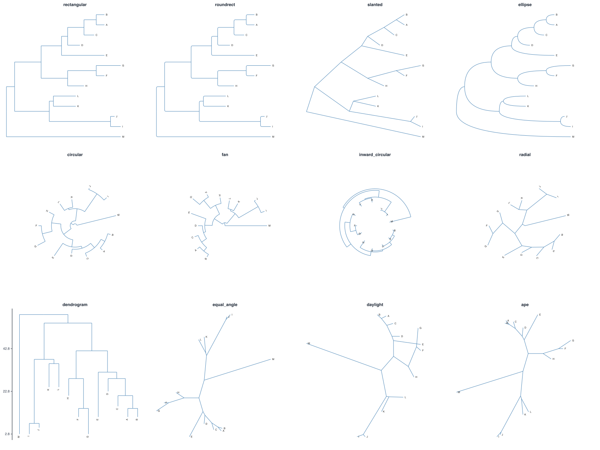
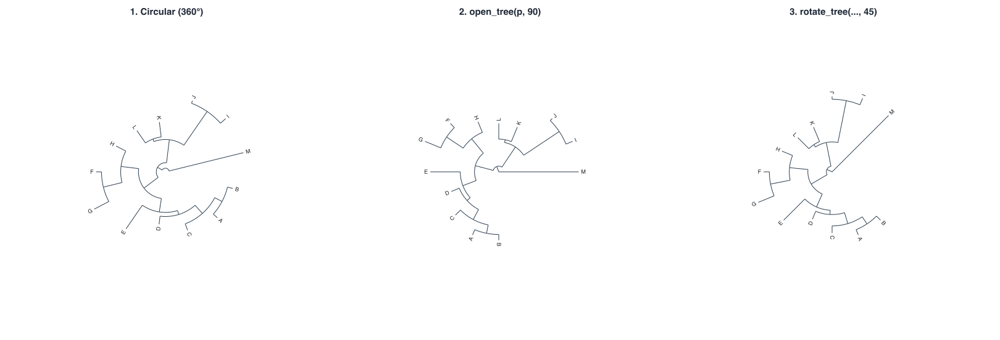
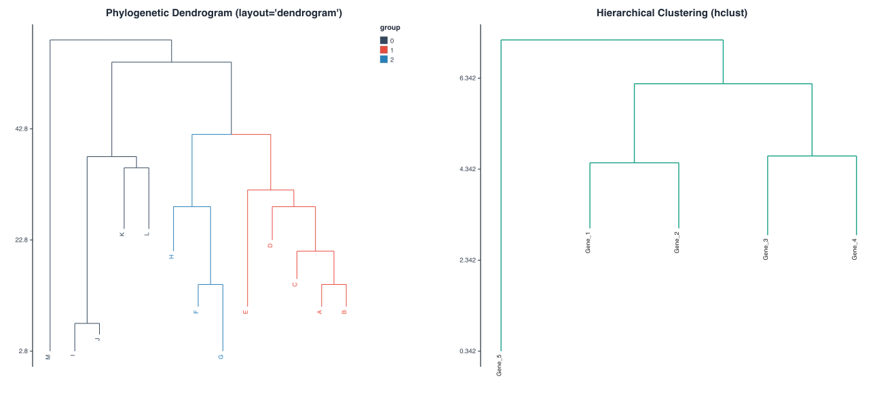
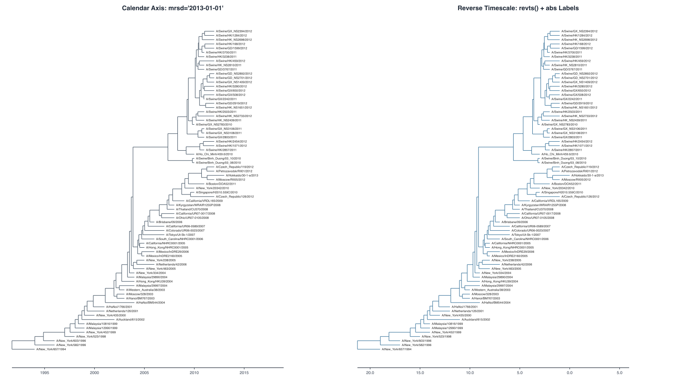
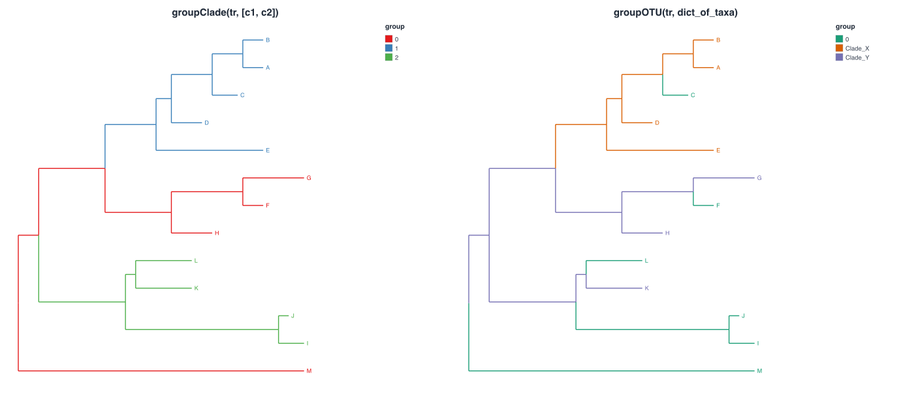
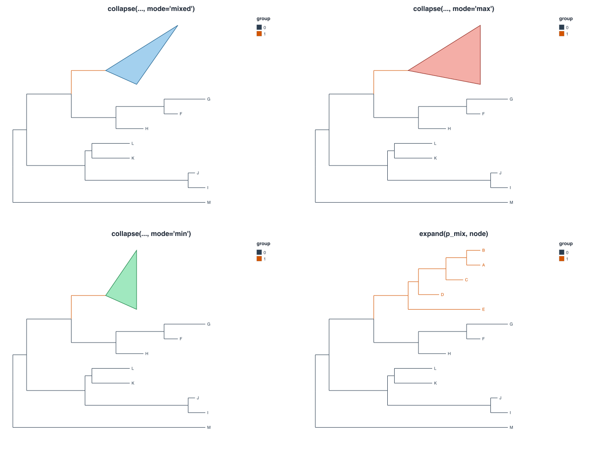
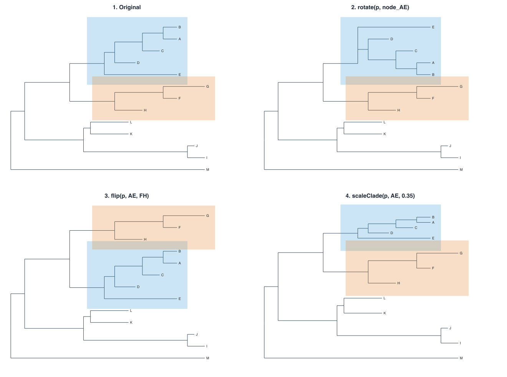
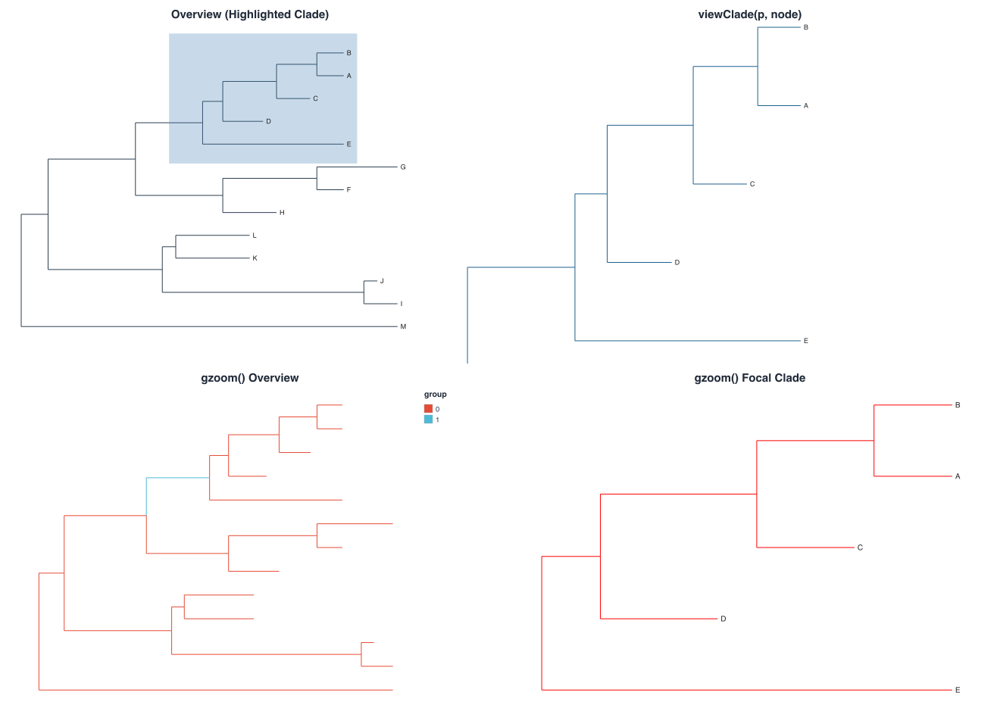
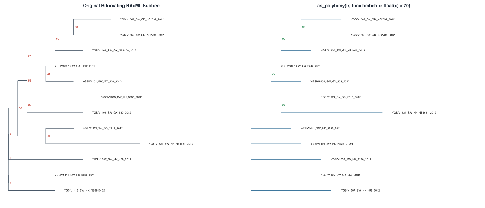

# Layouts & Tree Manipulation

> **Navigation:** [Docs Home](index.md) · [Online Book](https://zhanxw.github.io/ggtree-py-book/) · [Visual Gallery](gallery.md) · [Getting Started](getting_started.md) · [Layouts & Manipulation](layouts_and_manipulation.md) · [Annotations & Compositions](annotations_and_compositions.md) · [API Reference](api_reference.md) · [R-to-Python Migration](r_to_python_migration.md) · [GitHub](https://github.com/zhanxw/ggtree.py) · [PyPI](https://pypi.org/project/ggtree-py/)

## 1. Phylogenetic Layouts (`ggtree(..., layout=...)`)

`ggtree()` supports 12+ layout modes plus custom layout callables:

| Layout | Description |
| --- | --- |
| `"rectangular"` | Classic horizontal phylogram / cladogram (default) |
| `"slanted"` | Straight diagonal parent-to-child branches |
| `"circular"` | 360-degree polar phylogram (`coord_polar(theta="y", start=-pi/2, direction=-1)`) |
| `"fan"` | Open-angle polar fan tree (controlled by `open_angle=...`, e.g. `120`) |
| `"inward_circular"` | Circular layout growing inward toward the center (`xlim=...`) |
| `"radial"` | Polar tree layout without inner circular gap (`radial`) |
| `"dendrogram"` | Inverted vertical hierarchical tree (root at top, tips at bottom; pair with `theme_dendrogram()`) |
| `"equal_angle"` | Unrooted equal-angle algorithm |
| `"daylight"` / `"unrooted"` | Unrooted daylight optimization (`layoutDaylight`) |
| `"ape"` | Unrooted layout matching `ape` geometry |
| `"tidy"` | Compact non-overlapping vertical clade packing (`getYcoord_tidy`) |
| `"ellipse"` | Curved quadratic-Bezier rectangular branches |
| `"roundrect"` | Rounded-corner rectangular branches |
| `"tree_and_leaf"` | Radial / force-directed layout (`layoutTreeAndLeaf`) |

You can also pass a custom function `layout=fn` returning a coordinate `DataFrame`, or transform an existing plot using layout modifiers:



```python
import ggtree as gg

tr = gg.read_tree(gg.system_file("extdata", "sample.nwk", package="treeio"))

base = gg.ggtree(tr, layout="circular") + gg.geom_tiplab2() + gg.hexpand(0.15)
p_open = gg.open_tree(base, 90)
p_rot = gg.rotate_tree(p_open, 45)
base | p_open | p_rot
```



```python
tr_g = gg.groupClade(tr, [gg.MRCA(tr, "A", "E"), gg.MRCA(tr, "F", "H")])
p_dendro = gg.ggtree(tr_g, gg.aes(color="group"), layout="dendrogram") + gg.geom_tiplab() + gg.theme_dendrogram()
```



Available layout modifiers:
- `layout_rectangular()`, `layout_circular()`, `layout_fan(angle=180.0)`, `layout_inward_circular(xlim=None)`, `layout_dendrogram()`, `layout_ggtree(layout="rectangular", angle=180.0, xlim=None)`
- `open_tree(p, angle=180.0)` and `rotate_tree(p, angle)`

Verify tip alignment invariant with `tip_y_alignment(p)` (`"ok"` when tips are consistently ordered).

---

## 2. Time-Scaled Trees (`mrsd` & `revts`)

Specify the Most Recent Sampling Date via `mrsd="YYYY-MM-DD"` (or `as_Date=True`) to map node x-coordinates onto calendar years / dates:

```python
beast_tr = gg.read_beast(gg.system_file("extdata/MCC_FluA_H3.tree", package="ggtree"))

# Calendar time axis (e.g. 1990..2013)
p_cal = gg.ggtree(beast_tr, mrsd="2013-01-01") + gg.geom_tiplab(size=1.8) + gg.theme_tree2() + gg.hexpand(0.28)

# Reverse timescale (0 at tips, negative backward into the past; positive labels via abs)
p_rev = gg.revts(gg.ggtree(beast_tr)) + gg.geom_tiplab(size=1.8) + gg.theme_tree2() + gg.scale_x_continuous(labels=abs) + gg.hexpand(0.28)
p_cal | p_rev
```



Date helper functions exported in `ggtree`:
- `Date2decimal(x)` and `decimal2Date(x)`
- `scaleX_by_time_from_mrsd(df, mrsd, as_Date=False)`
- `scale_x_ggtree(...)`, `scale_x_date(...)`

---

## 3. Clade Selection, Grouping & Tree Manipulation

### Discovering & Grouping Clades

- `MRCA(tr, node1, node2, *more_nodes)` — Find most recent common ancestor node ID.
- `offspring(tr, node, tiponly=False, self_include=False, type="all")` — Descendants of a node (`"tips"`, `"internal"`, `"all"`).
- `ancestor(tr, node)`, `parent(tr, node)`, `child(tr, node)`, `sibling(tr, node)`, `rootnode(tr)`.
- `groupClade(tr, node, group_name="group")` — Assign clade group factor to subtree nodes/branches.
- `groupOTU(tr, tips, group_name="group", connect=False)` — Group operational taxonomic units (tips) and their connecting lineage.
- `tree_subset(tr, node, levels_back=5, group_node=True)` — Extract local neighborhood subtree around a focal node.

```python
c1, c2 = gg.MRCA(tr, "A", "E"), gg.MRCA(tr, "I", "L")
p_cl = gg.ggtree(gg.groupClade(tr, [c1, c2]), gg.aes(color="group")) + gg.geom_tiplab(gg.aes(color="group")) + gg.scale_color_brewer(palette="Set1")
p_otu = gg.ggtree(gg.groupOTU(tr, {"Clade_X": ["A", "B", "D", "E"], "Clade_Y": ["G", "H", "K"]}), gg.aes(color="group")) + gg.geom_tiplab(gg.aes(color="group")) + gg.scale_color_brewer(palette="Dark2")
p_cl | p_otu
```



### Collapsing, Rotating, Flipping & Zooming

| Function | Action |
| --- | --- |
| `collapse(p, node, mode="none", clade_name=None, height=None)` | Collapse a clade (`mode="none"`, `"min"`, `"max"`, `"mixed"`; supports `fill`/`alpha`/`color` styling in triangle modes) |
| `expand(p, node=None)` | Restore previously collapsed clade(s) |
| `rotate(p, node)` | Rotate order of children beneath `node` (`180°` swap) |
| `flip(p, node1, node2)` | Swap vertical positions of two sibling clades `node1` and `node2` |
| `scaleClade(p, node, scale=1.0, vertical_only=True)` | Expand or compress vertical spacing of a clade |
| `viewClade(p, node, xmax_adjust=0.0)` | Zoom viewport to frame a single clade |
| `zoomClade(p, node, xexpand=None)` / `geom_zoom_clade(node, ...)` | Highlight and expand view around a clade |
| `gzoom(tr, focus, subtree=False, widths=(0.3, 0.7))` | Side-by-side overview tree and zoomed focal clade panel (`PlotList`) |
| `reroot(tr, node)` | Re-root tree at `node` |
| `rescale_tree(tr, branch_length="rate")` | Replace branch lengths using another node attribute |
| `as_polytomy(tr, feature="node.label", fun=...)` | Collapse low-support internal edges into polytomies |
| `subtrees(tr)` | Extract list of all internal subtrees |
| `get_taxa_name(p, node=None)` | Return tip labels in display order (top-to-bottom / bottom-to-top) |

#### Collapsing & Expanding Clades (`collapse`, `expand`)

```python
p_mix = gg.collapse(base, node=c1, mode="mixed", fill="#3498DB", alpha=0.45, color="#1F618D")
p_max = gg.collapse(base, node=c1, mode="max", fill="#E74C3C", alpha=0.45, color="#922B21")
p_min = gg.collapse(base, node=c1, mode="min", fill="#2ECC71", alpha=0.45, color="#1E8449")
p_exp = gg.expand(p_mix, node=c1)
(p_mix | p_max) / (p_min | p_exp)
```



#### Reordering & Rescaling Clades (`rotate`, `flip`, `scaleClade`)

```python
c_ae, c_fh = gg.MRCA(tr, "A", "E"), gg.MRCA(tr, "F", "H")
(base | gg.rotate(base, c_ae)) / (gg.flip(base, c_ae, c_fh) | gg.scaleClade(base, c_ae, scale=0.35))
```



#### Framing Subtrees (`viewClade`, `gzoom`)



#### Collapsing Low-Support Branches (`as_polytomy`)

```python
raxml_sub = gg.extract_clade(gg.read_tree(gg.system_file("extdata", "RAxML", "RAxML_bipartitions.H3", package="treeio")), 94)
poly_tr = gg.as_polytomy(raxml_sub, feature="node.label", fun=lambda x: float(x) < 70)
```


