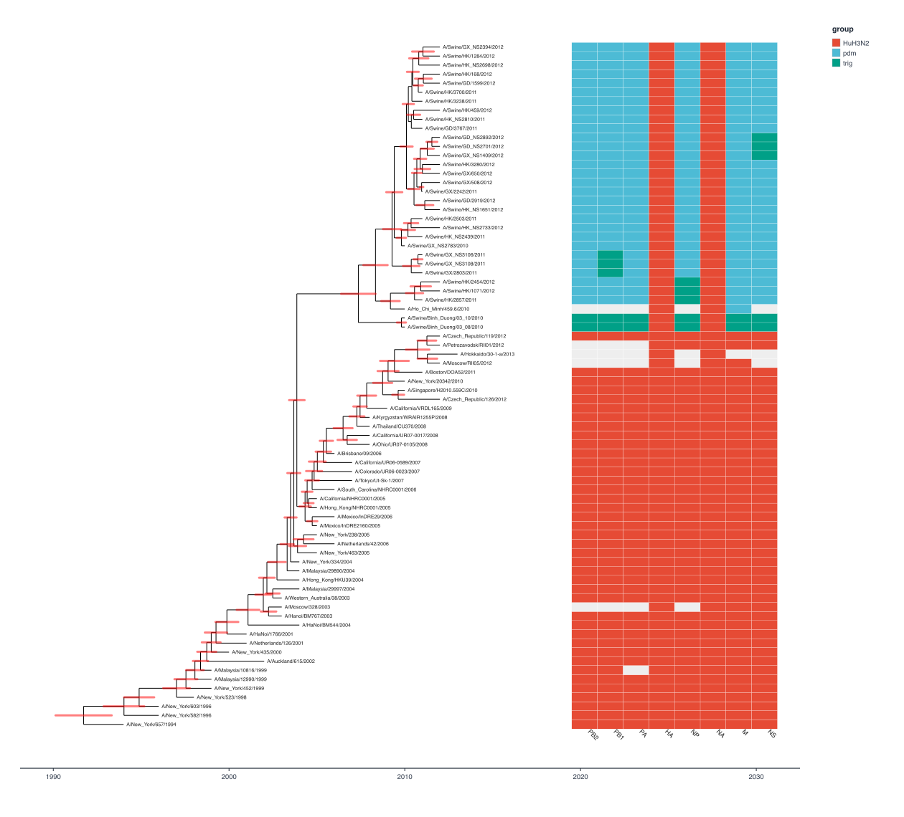

# R-to-Python Migration Guide

> **Navigation:** [Docs Home](index.md) · [Visual Gallery](gallery.md) · [Getting Started](getting_started.md) · [Layouts & Manipulation](layouts_and_manipulation.md) · [Annotations & Compositions](annotations_and_compositions.md) · [API Reference](api_reference.md) · [R-to-Python Migration](r_to_python_migration.md) · [GitHub](https://github.com/zhanxw/ggtree.py) · [PyPI](https://pypi.org/project/ggtree-py/)

Because `ggtree-py` preserves R `ggtree` conventions closely, porting an existing R workflow requires only a few mechanical adjustments.

## 1. Key Syntax Differences

| Feature | R `ggtree` | Python `ggtree` |
| --- | --- | --- |
| Dots in function names | `read.tree()`, `read.beast()`, `system.file()`, `set.seed()`, `data.frame()`, `as.polytomy()` | Snake-case (`read_tree()`, `read_beast()`, `system_file()`, `set_seed()`, `data_frame()`, `as_polytomy()`), OR R dot-call namespaces (`read.tree()`, `read.beast()`, `system.file()`, `data.frame()`, `set_.seed()`, `as_.polytomy()`) |
| Dots in parameter names | `font.size = 3`, `branch.length = "none"`, `open.angle = 90`, `as.Date = TRUE`, `offset.text = 0.5` | Snake-case (`font_size=3`, `branch_length="none"`, `open_angle=90`, `as_Date=True`, `offset_text=0.5`); dotted forms are also accepted via `**kwargs` in key entry points such as `ggtree()` |
| Subsetting nodes in `aes()` | `aes(subset = !isTip)` | `aes(subset=~isTip)` or string `aes(subset="!isTip")` |
| Attaching metadata (`%<+%`) | `p %<+% df` | `p % df` (also `p << df` or `p @ df`) |
| Replacing tree (`%<%`) | `p %<% new_tree` | `p % new_tree` |
| Named vectors | `c(a = "#FF0000", b = "#0000FF")` | `{"a": "#FF0000", "b": "#0000FF"}` or `c(a="#FF0000", b="#0000FF")` |
| Unnamed vectors | `c("A", "B", "C")` | `["A", "B", "C"]` or `c("A", "B", "C")` |
| Booleans / NA / NULL | `TRUE`, `FALSE`, `NA`, `NULL` | `True`/`TRUE`, `False`/`FALSE`, `None`/`NA`/`NULL` |
| Parenthesized multiline expressions | Multiline `+` chains work naturally after `<-` | Wrap multiline `+`, `\|`, `/` chains inside outer `(...)` |

## 2. Example Translation

**R:**
```r
library(ggtree)
library(treeio)

beast_tree <- read.beast(system.file("extdata/MCC_FluA_H3.tree", package = "ggtree"))
genotype <- read.table(system.file("extdata/Genotype.txt", package = "ggtree"), sep = "\t", stringsAsFactors = FALSE)

p <- ggtree(beast_tree, mrsd = "2013-01-01") +
  geom_range("height_0.95_HPD", color = "red", size = 1.5, alpha = 0.5) +
  geom_tiplab(size = 2) +
  theme_tree2()

gheatmap(p, genotype, offset = 5, width = 0.5, font.size = 3, colnames_angle = -45, hjust = 0)
```

**Python:**
```python
from ggtree import *

beast_tree = read_beast(system_file("extdata/MCC_FluA_H3.tree", package="ggtree"))
genotype = read_table(system_file("extdata/Genotype.txt", package="ggtree"), sep="\t")

p = (
    ggtree(beast_tree, mrsd="2013-01-01")
    + geom_range("height_0.95_HPD", color="red", size=1.5, alpha=0.5)
    + geom_tiplab(size=2)
    + theme_tree2()
)

phm = gheatmap(p, genotype, offset=6.5, width=0.55, font_size=2.8, colnames_angle=-45, hjust=0)
ggsave("flu_beast_heatmap.png", plot=phm, width=10.5, height=9.5, dpi=120)
```


